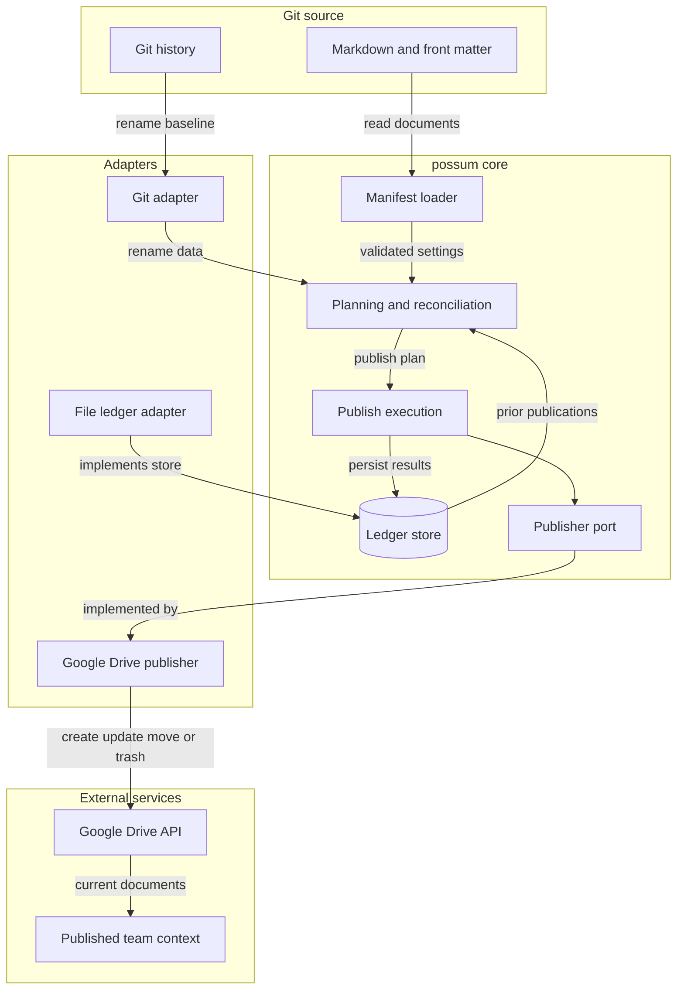
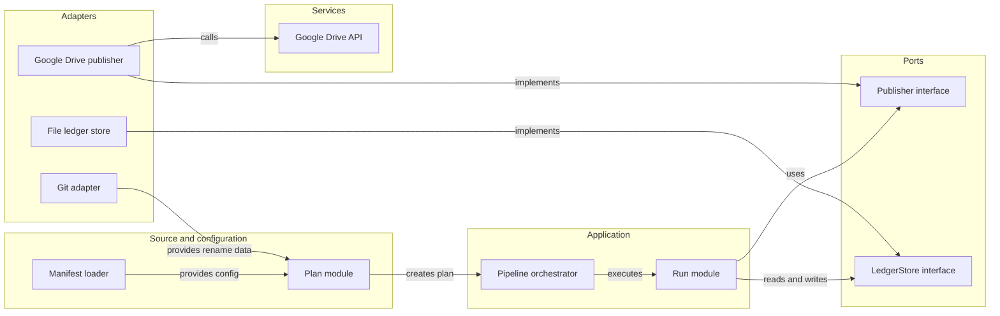

# Architecture Diagram

possum is a Git-native document publishing engine. Its application core plans
and executes publication through ports, while destination-specific adapters
handle Google Docs today and other publishing surfaces in the future.

## Application Architecture

<!-- mermaid-checked: no \n, no em-dash/en-dash, no {} in labels, subgraphs are id["label"], arrows are -->|"label"|, all subgraphs closed by end, ids unique -->

### Technology Stack Summary

| Layer           | Technology                | Version                  | Purpose                           |
| --------------- | ------------------------- | ------------------------ | --------------------------------- |
| Runtime         | Node.js                   | 22+                      | Executes the CLI and pipeline     |
| Language        | TypeScript                | 5.9                      | Type-safe engine implementation   |
| Configuration   | YAML and Zod              | YAML 2, Zod 3            | Loads and validates `possum.yaml` |
| Source format   | Markdown and front matter | gray-matter 4            | Reads Git-native documents        |
| Publisher       | Google Drive API          | googleapis 144           | Creates and updates Google Docs   |
| Build and tests | TypeScript, Vitest        | TypeScript 5.9, Vitest 2 | Builds and validates the engine   |

### Data Storage & External Services

The committed ledger stores source paths, provider identifiers, destination
file IDs, URLs, content hashes, and the last synced Git commit. The Google Drive
API is the V1 external service and receives rendered DOCX content for conversion
to Google Docs. The service-account key is supplied through the environment or
CI secret and is not part of the manifest.

### Key Architectural Decisions

- The core uses ports and adapters so new publishing destinations do not require
  changes to planning or execution logic.
- Content hashes make repeated runs idempotent, while the ledger preserves
  stable destination URLs across updates and renames.
- `cli/main.ts` is the composition root; it wires concrete adapters into the
  publisher-agnostic application core.

## Component Relationships

<!-- mermaid-checked: no \n, no em-dash/en-dash, no {} in labels, subgraphs are id["label"], arrows are -->|"label"|, all subgraphs closed by end, ids unique -->

### Component Inventory

| Component                       | Layer                    | Type            | Responsibility                                      |
| ------------------------------- | ------------------------ | --------------- | --------------------------------------------------- |
| `config/manifest.ts`            | Source and configuration | Loader          | Validates manifest settings                         |
| `app/plan.ts`                   | Application              | Planner         | Discovers, routes, hashes, and reconciles documents |
| `app/pipeline.ts`               | Application              | Orchestrator    | Coordinates planning, execution, and run reports    |
| `app/run.ts`                    | Application              | Executor        | Runs actions and persists successful ledger changes |
| `ports/publisher.ts`            | Ports                    | Interface       | Defines destination operations                      |
| `ports/ledger-store.ts`         | Ports                    | Interface       | Defines ledger persistence                          |
| `adapters/git.ts`               | Adapters                 | Git adapter     | Reads the current commit and detects renames        |
| `adapters/file-ledger-store.ts` | Adapters                 | Storage adapter | Persists the machine-managed ledger                 |
| `publishers/google-drive/`      | Adapters                 | Publisher       | Renders and publishes documents to Google Drive     |
