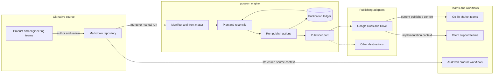
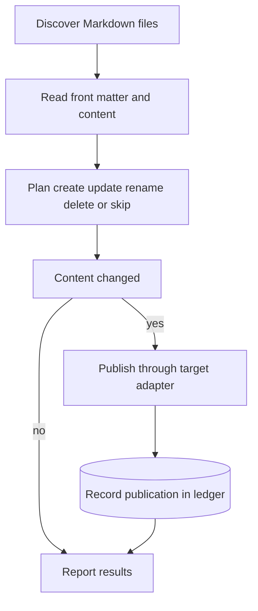

# possum

## Introduction

`possum` is a Git-native document publishing engine for teams building products
with AI-driven workflows. It publishes Markdown from Git to one or more
consumption surfaces while keeping Git as the canonical source. Google Docs is
the first V1 publisher, not the limit of the engine.

## Context

Product roadmaps, delivery checkpoints, and implementation notes often become
outdated when they are copied manually into tools used by other teams. possum
keeps those documents close to the product work and publishes the latest
approved version after changes are merged.

This gives Go To Market teams current roadmap context for outreach and planning.
It also gives account managers, account executives, and field engineers the
implementation information they need to resolve client issues faster, without
requiring access to the code or waiting on developers for every answer.

The published copy is not authoritative. Edit the Markdown and open a pull
request; changes made directly in a destination are overwritten by the next
publish.

## System architecture

Markdown repositories provide the source. CI invokes the possum pipeline, which
plans and executes publication through a `Publisher` port. The V1 implementation
uses Google Drive and Google Docs; additional publishers can be added as
adapters without changing the core pipeline.

<!-- mermaid-checked: no \n, no em-dash/en-dash, no {} in labels, subgraphs are id["label"], arrows are -->|"label"|, all subgraphs closed by end, ids unique -->



The core is deliberately publisher-agnostic: `domain`, `ports`, and `app` do
not import Google-specific or storage-specific code. Google Docs is the current
adapter; future adapters can publish to other destinations.

## Adopt possum in your repository

### 1. Add `possum.yaml`

Create this file at the repository root:

```yaml
version: 1

source:
  type: git
  docsDir: docs

targets:
  - name: google-docs
    type: google-docs
    driveFolderId: "<Google Drive folder ID>"
    orgDomain: example.com
    mode: mirror

defaults:
  onUnchanged: skip
  onDelete: trash
  publish: [google-docs]

ledger: ledger.json
```

`driveFolderId`, `orgDomain`, target names, and other structural settings are
safe to commit. The service-account key is a secret and must not be put in this
file. `ledger.json` is machine-managed state: commit it, but do not edit it by
hand.

### 2. Add documents

Put Markdown files below `docs/`. A document is published by the manifest
default, or can select targets explicitly with front matter:

```markdown
---
title: Payments overview
publish: [google-docs]
---

# Payments
```

The Google Doc title comes from `title`, or from the Markdown filename. Folders
under `docs/` are mirrored below the configured Drive folder.

### 3. Configure Google access

1. Create a Google Cloud project and enable the **Google Drive API**.
2. Create a service account and download its JSON key.
3. Share the destination Drive folder with the service-account email as
   **Editor**. For a Shared Drive, add it as **Content Manager**.
4. Add the complete JSON key as the repository secret
   `GOOGLE_SERVICE_ACCOUNT_JSON`.

Keep the key outside the repository locally and in GitHub Actions secrets in CI.

### 4. Add the workflow

Copy [`examples/possum-adopter.yml`](examples/possum-adopter.yml) to
`.github/workflows/docs.yml`. It runs a read-only plan on pull requests and
publishes after changes reach `main`:

```yaml
name: Publish docs

on:
  push:
    branches: [main]
    paths: ["docs/**"]
  pull_request:
    paths: ["docs/**"]

jobs:
  possum:
    permissions:
      contents: write
      pull-requests: write
    uses: bhaveshdarpan/possum/.github/workflows/publish.yml@main
    with:
      command: ${{ github.event_name == 'pull_request' && 'plan' || 'push' }}
    secrets:
      google-credentials-json: ${{ secrets.GOOGLE_SERVICE_ACCOUNT_JSON }}
```

Pin the reusable workflow to a release tag when one is available. The reusable
workflow checks out full Git history, runs possum, commits the updated ledger
after a publish, and posts the plan to pull requests.

For custom CI, use the composite action in [`action.yml`](action.yml). It builds
the engine and runs `plan` or `push`, but does not commit the ledger or comment
on pull requests.

## Functionality

- **Plan:** `possum plan` shows create, update, rename, delete, and skip actions
  without writing files or requiring credentials.
- **Publish:** `possum push` executes the configured publisher and updates the
  ledger. V1 wires Google Docs and Google Drive.
- **Publisher ports:** the application core is destination-agnostic; publishers
  are adapters under `src/publishers/`.
- **Markdown discovery:** recursively scans the configured `docsDir` for `.md`
  files and reads front matter.
- **Routing:** `publish: []` excludes a document; an omitted `publish` uses
  `defaults.publish`.
- **Idempotency:** content hashes skip unchanged documents.
- **Stable URLs:** updates and renames reuse the existing Google file.
- **Renames and deletes:** Git rename detection preserves the destination;
  deleted sources are trashed by default, or can be archived or ignored with
  `onDelete`.
- **Failure isolation:** one document failure does not block other documents;
  successful ledger entries are persisted and the command exits non-zero.
- **Markdown conversion:** Markdown is rendered to DOCX and uploaded to Drive,
  where it becomes a Google Doc. Mermaid blocks are rendered as images.

### Publish lifecycle

<!-- mermaid-checked: no \n, no em-dash/en-dash, no {} in labels, subgraphs are id["label"], arrows are -->|"label"|, all subgraphs closed by end, ids unique -->



CLI examples:

```bash
npm install
npm run build
node dist/cli/cli.js plan
node dist/cli/cli.js push
node dist/cli/cli.js push --manifest path/to/possum.yaml
```

`push` requires `GOOGLE_APPLICATION_CREDENTIALS` to point to a service-account
JSON file. `plan` is read-only and needs no credentials.

## Layout

```text
docs/                          # Markdown source of truth
possum.yaml                    # committed manifest
ledger.json                    # committed, machine-managed publication state
src/
  domain/                      # documents, targets, ledger, publish plans
  ports/                       # Publisher and LedgerStore interfaces
  app/                         # planning, execution, and pipeline orchestration
  publishers/                  # destination adapters; Google Drive is V1
    google-drive/              # Google Drive publisher and DOCX rendering
  adapters/                    # Git and file-ledger adapters
  config/                      # manifest parsing and validation
  cli/                         # composition root and CLI presentation
test/                          # unit, acceptance, and contract tests
notes/                         # product, architecture, ADR, and testing notes
```

The core (`domain`, `ports`, and `app`) depends only on domain types and ports.
Adapters and publishers point inward, while `cli/main.ts` wires concrete
implementations together. This boundary is checked by
`npm run lint:boundaries`.

## Documentation

- [Product requirements](notes/product/prd.md)
- [System design](notes/architecture/system-design.md)
- [Domain model](notes/architecture/domain-model.md)
- [Code structure](notes/architecture/code-structure.md)
- [Architecture decision records](notes/architecture/adr/)
- [Testing strategy](notes/testing/testing-strategy.md)
- [Architecture diagrams](.github/modernize/assessment/engines/facts/architecture-diagram.md)
- [Migration notes](notes/MIGRATION.md)
- [Sample adopter workflow](examples/possum-adopter.yml)
- [Sample documents](docs/)

The previous README is preserved at
[`notes/README.current.md`](notes/README.current.md).
