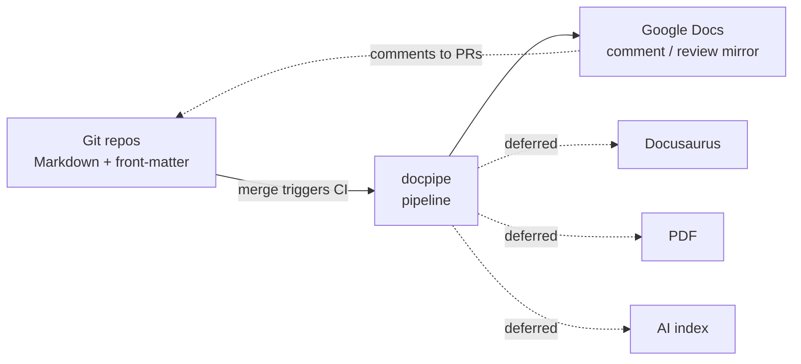

# documentation-repository

Canonical home for product/technical docs, plus the pluggable pipeline that publishes them.

Docs are written once as Markdown in Git (single source of truth) and **published** one‑way to consumption surfaces. Only review feedback flows back, as pull requests.

> **Status:** V1 in design; specs in [`docs/`](docs/). A working PoC exists locally and is being reconciled with these specs.

## Flow (V1)



## V1 scope

- **Store:** Markdown in Git, one or many repos.
- **Pipeline:** config‑driven engine `docpipe`; a repo adopts it with a manifest + shared CI workflow — no repo‑specific code.
- **One publisher:** Google Docs (one‑way mirror).

**Deferred** (designed for, not built): Docusaurus, PDF, AI index, versioning, per‑doc access control.

## Approach

- **DDD** — bounded contexts + one ubiquitous language: [domain model](docs/architecture/domain-model.md).
- **BDD** — behaviour specified in Gherkin, executable: [testing strategy](docs/testing/testing-strategy.md).

## Why this exists

- **Edit the Markdown, not the Doc.** The Doc is a read-only published mirror (org gets commenter access on creation). Direct edits will be overwritten on the next sync.
- **Document URLs are stable.** Edits update the existing Doc in place, so external links keep working.

## Adopt in 3 steps

1. Add `docpipe.yaml` (below).
2. Call the shared CI workflow on merge to the default branch.
3. Add `publish:` front‑matter to docs you want mirrored.

```yaml
# docpipe.yaml
version: 1
source: { type: git, docsDir: docs }
targets:
  - {
      name: google-docs,
      type: google-docs,
      driveFolderId: "<id>",
      mode: mirror,
    }
defaults: { onUnchanged: skip, publish: [google-docs] }
```

```yaml
# per-document front-matter
---
title: Payments overview
owner: payments-team
publish: [google-docs]
gdoc: "<filled-in-on-first-publish>"
---
```

The Doc name in Drive is taken from `title` if present, otherwise from the filename. Folder hierarchy under `docs/` is mirrored under the Drive root folder. Files outside `docs/` are ignored.

## Workflow

1. Branch from `main`.
2. Create or edit a file under `docs/` (e.g. `docs/product/prd.md`).
3. Open a PR. Review on the Markdown diff.
4. Merge.
5. Publish — either automatically on merge (CI) or manually with `npm run push`.

## Run modes

- **Dry‑run (PR check):** `npm run dry-run` — print the create/update/rename/delete/skip plan without writing anything. Needs **no** service‑account key (planning is read‑only). `.github/workflows/dry-run.yml` runs it on every PR touching `docs/**`, posts the plan as a job summary + sticky PR comment, and fails on an invalid manifest.
- **Manual:** `npm run push` — sync `docs/**` to Drive on demand. After a successful run, commit the updated `_index.json` ledger.
- **On merge:** `.github/workflows/sync.yml` runs on push to `main` under `docs/**`, then commits the updated `_index.json` ledger back with `[skip ci]`.

Config lives in the committed manifest; the **service‑account key stays a secret** (env / CI secret), never in the manifest.

## Setup

### Prerequisites

- Node.js 22+
- A Google account that can create Cloud projects and share Drive folders in your org

### 1. Create a Google Cloud project and enable the Drive API

1. Open the [Google Cloud Console](https://console.cloud.google.com) and create a new project (or reuse one).
2. Go to **APIs & Services → Library**, search for **Google Drive API**, and click **Enable**.

The Docs API is **not** required for v1 — we upload `.docx` and let Drive auto-convert it to a Google Doc. Enable it later only if you start using `docs.documents.batchUpdate`.

### 2. Create a service account and download its key

1. **APIs & Services → Credentials → Create credentials → Service account.**
2. Give it a name (e.g. `docs-sync`) and click **Create and continue**.
3. **Grant access to project**: leave both _Select a role_ and _Principals with access_ blank — Drive access is controlled by folder sharing, not GCP IAM. Click **Continue**, then **Done**.
4. Open the new service account, go to the **Keys** tab, **Add key → Create new key → JSON**. A `.json` file downloads.
5. Move the key file somewhere stable and outside the repo, e.g. `~/.config/docs-sync/service-account.json`. **Never commit it.** (The repo's `.gitignore` already blocks `service-account*.json` and `*-credentials.json`, but keeping the key out of the working tree entirely is safer.)
6. Note the service account email — it looks like `docs-sync@<project-id>.iam.gserviceaccount.com`. You'll paste it into Drive in the next step.

You do **not** need:

- Domain-wide delegation (only for impersonating end users).
- Project IAM roles like Owner / Editor (those are for GCP resources, not Drive).

### 3. Set up the Drive root folder

1. In Google Drive, create the folder that will hold all synced Docs (e.g. `Product Docs`).
2. Open it and copy the **folder ID** from the URL — the segment after `/folders/`:
   `https://drive.google.com/drive/folders/`**`1AbCdEf...XyZ`** → ID is `1AbCdEf...XyZ`.
3. Share the folder with the service account email:
   - **My Drive folder:** click **Share**, paste the SA email, set role to **Editor**, uncheck **Notify people**, click **Share**.
   - **Shared Drive:** sharing the folder alone is not enough. Open the Shared Drive → **Manage members** → add the SA email as **Content Manager**.

If Drive says "We couldn't find this user," your Workspace has external-visitor sharing restricted. Either use a Shared Drive (works around it) or have an admin relax the OU's sharing setting.

### 4. Local config

```bash
npm install
cp .env.example .env
```

The service-account key is the only **secret** — it lives in `.env`:

```dotenv
GOOGLE_APPLICATION_CREDENTIALS=/absolute/path/to/service-account.json
```

Everything else is **structural config** and lives in the committed `docpipe.yaml` (ADR-0003). Set the Drive folder ID from step 3 and your Workspace domain on the `google-docs` target:

```yaml
targets:
  - name: google-docs
    type: google-docs
    driveFolderId: "<folder ID from step 3>"
    orgDomain: example.com
    mode: mirror
```

`orgDomain` is the Workspace domain that gets commenter access on every new Doc. If you're testing with a personal `@gmail.com` account, `type: domain` permission grants won't work — see _Personal account testing_ at the bottom.

### 5. Verify the setup

```bash
npm run typecheck

mkdir -p docs/prd
cat > docs/prd/sync-smoke-test.md <<'EOF'
---
title: Sync smoke test
status: draft
---
# Hello from docs-sync
This file should appear as a Google Doc under the configured root folder.
EOF

npm run push
```

You should see a `create` line printed with a URL, the Doc should appear in Drive under your root folder, and `_index.json` should gain an entry. Running `npm run push` again should print `skip` for the unchanged file.

### Personal account testing

`type: domain` permission grants require a Workspace domain. If you're using a personal Google account just to try this out, replace the `grantDomainCommenter` call in [src/orchestrator/run.ts](src/orchestrator/run.ts) with a `type: user` grant to your own email — or comment it out entirely. The Doc will then only be visible to whoever has access to the root folder (you and the SA), which is fine for solo testing.

## Running

```bash
npm run push       # sync docs/** to Drive
npm run dry-run    # print the plan only — no writes, no credentials needed
npm run typecheck  # tsc --noEmit
npm test           # vitest
```

`npm run push` scans `docs/**/*.md`, compares each file's hash against `_index.json`, and creates/updates the matching Google Doc. Unchanged files are skipped. After a successful run, commit `_index.json`.

## Layout

Hexagonal layout (ADR-0006): the core (`domain`, `ports`, `app`) depends on nothing outside itself; adapters point inward; `cli` is the only composition root.

```text
docs/                          # source of truth (Markdown)
src/
  domain/                      # Document, Ledger, Target, PublishPlan — types + pure rules
  ports/                       # Publisher, LedgerStore — interfaces adapters implement
  app/
    plan.ts                    # walk docs/, hash, route, reconcile (create/update/rename/delete/skip)
    run.ts                     # execute a PublishPlan; per-action ledger bookkeeping
  publishers/google-drive/     # GoogleDrivePublisher: docx render, folders, files, permissions
  adapters/
    git.ts                     # HEAD + rename detection
    file-ledger-store.ts       # read / write _index.json (implements LedgerStore)
    ledger-schema.ts           # zod schema for the ledger
  config.ts                    # env secrets (service-account key)
  config/manifest.ts           # docpipe.yaml schema + fail-fast loader
  cli/main.ts                  # entrypoint — wires publishers to the core
scripts/
  push.ts                      # thin wrapper (supports --dry-run)
docpipe.yaml                   # committed manifest (source, targets, defaults)
_index.json                    # ledger: path → provider → { fileId, url, hash }; + lastSyncedSha
```

## Docs

[PRD](docs/product/prd.md) · [Domain model](docs/architecture/domain-model.md) · [System design](docs/architecture/system-design.md) · [ADRs](docs/architecture/adr/) · [Testing strategy](docs/testing/testing-strategy.md)
