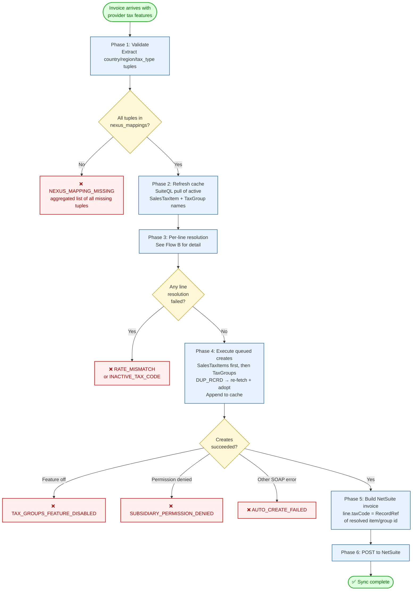
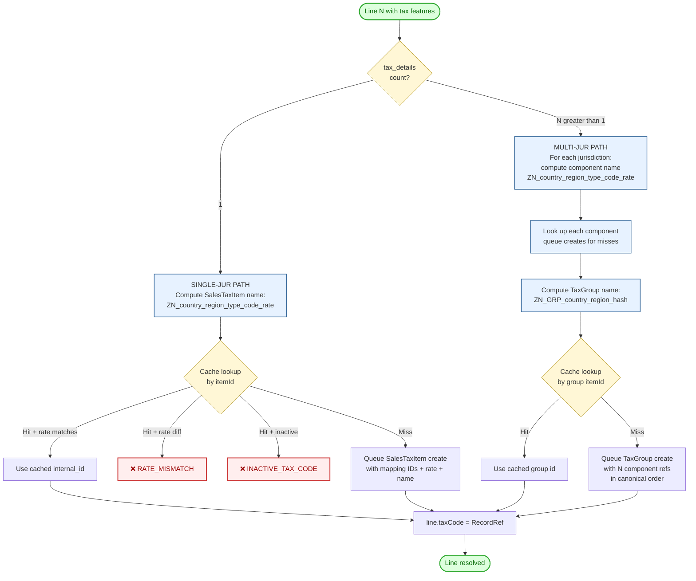

# NetSuite × Multi-Provider Tax Sync — PRD

> Companion to [netsuite-tax-implementation-plan.md](netsuite-tax-implementation-plan.md)
> (the lookup-or-fail manual plan, shipped on `feat/netsuite-tax-invoice-wireup`).
> Scope: extend that slice to support **upstream tax engines** (Avalara,
> TaxJar, Anrok, Stripe Tax, etc.) by auto-creating the rate-bearing
> NetSuite tax records (`SalesTaxItem`, `TaxGroup`) on demand, while
> keeping the customer in control of all higher-level tax-record
> provisioning. **Legacy Tax only** — SuiteTax remains out of scope.

---

## TL;DR

When a Zenskar customer uses an external tax engine (Avalara, TaxJar,
Anrok, Stripe Tax) and syncs invoices to NetSuite, the customer cannot
pre-create every possible NetSuite tax record by hand — jurisdiction
stacks are dynamic, hash-derived, and effectively unbounded for US/CA
tenants. The current lookup-or-fail flow blocks the first invoice that
lands with an unseen jurisdiction.

This PRD extends the NetSuite tax slice to **lookup-or-discover-or-create**,
with three boundaries baked in:

1. **Auto-create only `SalesTaxItem` and `TaxGroup`** records. Never
   `TaxAgency`, `TaxType`, `Nexus`, or `Subsidiary` — those stay
   customer-owned.
2. **Provider-neutral mapping schema**: a per-nexus mapping table keyed
   by `(country, region, tax_type)` resolves to the customer's NetSuite
   IDs. Works for Avalara today, TaxJar / Anrok / Stripe Tax later,
   manual tax forever.
3. **Strict mode**: every mapping gap fails the sync with a typed,
   actionable error. No silent fallbacks. No drift.

Both single-jurisdiction and multi-jurisdiction invoices are in scope
from day one. Frontend supports manual mode as a first-class option;
provider integration is opt-in per connector.

---

## 1. Problem Statement

The current NetSuite tax slice is **lookup-or-fail**. Customers using a
manual or upstream-fixed tax model (UK VAT, India GST, single-rate
countries) can pre-create one `SalesTaxItem` per code in NetSuite, map
`UK_VAT_20 → <internal id>` in the connector tax config, and the
resolver does the rest at sync time. Missing mapping → `TAX_CODE_MISSING`;
inactive → `INACTIVE_TAX_CODE`; rate drift → `RATE_MISMATCH`. This
works because the **set of keys is bounded and known up-front**.

When an **upstream tax engine** is in the loop, that assumption breaks:

- Tax engines compute the jurisdiction stack per invoice based on the
  ship-to address. For US/CA invoices, the stack is a composition of
  state + county + city + special-district rates. Each unique
  composition produces a unique Zenskar key (e.g.
  `ZN_OAKLAND_US_a1b2c3d4e5f6g7h8`). The key is hash-derived; a human
  cannot enumerate the possible values up-front.
- A mid-sized US tenant selling across 30 states routinely hits
  hundreds of distinct compositions across a quarter. Pre-creating
  hundreds of `TaxGroup` records by hand in NetSuite — each one
  stitching N component `SalesTaxItem`s with the right tax agency +
  tax type — is not a workflow any tax accountant signs up for.
- Even single-rate countries get tax-engine-derived keys whose rate
  precision (Avalara goes to 4–6 decimals) doesn't always round-trip
  cleanly against NetSuite's stored `salestaxitem.rate`. The current
  `RATE_MISMATCH` guard fires too eagerly.
- The first invoice that lands with an unseen composition fails the
  sync. The customer has no workflow to "discover, create, map, retry"
  except manually walking three NetSuite forms per jurisdiction.

The customer-facing outcome: **every tenant on an upstream tax engine
blocks on the first US/CA multi-jurisdiction invoice**. The existing
slice's "fail fast, ask the customer to pre-create" guidance is
unactionable in this mode.

---

## 2. Context: How Tax Engines Meet NetSuite Legacy Tax

Avalara is the primary case driving this PRD, but the architecture is
deliberately provider-neutral (§4.2). Full Legacy Tax primer is in
[netsuite-tax-implementation-plan.md §2](netsuite-tax-implementation-plan.md);
this section captures only what's load-bearing for the solutioning.

### 2.1 What an upstream tax engine hands to the connector

Every taxable invoice line carries a `Tax` feature with:

- `tax_codes` — Zenskar's derived key (provider-agnostic at this
  point).
- `rate` — total rate across all jurisdictions.
- `tax_details: List[TaxJurisdiction]` — per-jurisdiction breakdown.
  One entry for single-rate, N entries for multi. Each carries
  `juris_code`, `juris_name`, `juris_type` (STA/CTY/CIT/STJ/CNT),
  `rate`, `tax_name`, `country`, `region`.

For Avalara specifically, a representative transaction line looks
like:

```json
{
  "country": "US",
  "region": "CA",
  "taxCode": "PS081282",     // Avalara PRODUCT category — IGNORED for mapping
  "tax": 62.5,
  "taxableAmount": 1000,
  "details": [{
    "country": "US",
    "region": "CA",
    "stateFIPS": "06",
    "jurisCode": "06",
    "jurisName": "CALIFORNIA",
    "jurisType": "STA",
    "rate": 0.0625,           // 6.25%
    "tax": 62.5,
    "taxableAmount": 1000,
    "taxType": "Sales",
    "taxName": "CA STATE TAX",
    "jurisdictionId": 5000531
  }]
}
```

Critical: the line-level `taxCode` field on the Avalara payload is
the **product tax category** (e.g., "PS081282" = yarn), not the
jurisdiction code. We use `details[*]` for jurisdiction resolution.

### 2.2 What NetSuite Legacy Tax needs at the line-write boundary

A single `taxCode` reference per line, pointing at either:

- A `SalesTaxItem` `internalId` — single rate; references one
  `TaxAgency` + one `TaxType`.
- A `TaxGroup` `internalId` — composition; references N child
  `SalesTaxItem`s in an ordered sublist. NetSuite's tax reports
  preserve the component order.

Both records are subsidiary-scoped. Both reference a `TaxAgency`
(vendor flagged "Tax agency") either directly (item) or via members
(group).

### 2.3 The minimum dependency chain to create a `TaxGroup`

Reading bottom-up — every layer must exist before the layer above
can be created:

```text
TaxGroup                                       ← auto-created by Zenskar
  ↓ taxItemList[*]
SalesTaxItem (× N members)                     ← auto-created by Zenskar
  ↓ requires
  ├── TaxType                                  ← customer-owned
  │     ↓ requires
  │     ├── Nexus                              ← customer-owned
  │     └── Tax Control Account (GL)           ← customer-owned
  ├── TaxAgency (Vendor)                       ← customer-owned
  ├── Nexus                                    ← customer-owned
  └── Subsidiary                               ← customer-owned

Plus enabled features:
  • "Tax Groups" — gates the TaxGroup record (Setup → Accounting
    → Taxes → "Tax Code Lists Include")
  • "Advanced Taxes" — gates tax schedules
```

The auto-create scope (§4.3) is locked to the top two records.
Everything else is customer-owned because (a) those records require
real-world tax-registration decisions Zenskar can't make, and (b)
auto-creating them pollutes NetSuite's native tax reports — see §3
challenge C9.

---

## 3. Challenges Specific to Tax-Engine-Driven Sync

Twelve challenges shape this PRD. Eight are inherited from
[netsuite-tax-implementation-plan.md §2.4](netsuite-tax-implementation-plan.md);
four are tax-engine-specific (C1, C2, C9, C10). For each, the
disposition in this PRD is recorded so the design choices are
traceable back to the problem.

### C1. Unbounded, hash-derived key space (engine-driven)

Avalara emits a unique key per jurisdiction composition. US tenants
hit hundreds of unique keys per quarter. **Addressed by**: auto-
creation under deterministic naming convention (§4.4); first invoice
in a jurisdiction provisions records, subsequent invoices are cache
hits.

### C2. Keys are not human-readable (engine-driven)

`ZN_OAKLAND_US_a1b2c3d4e5f6g7h8` is not a name a tax accountant
types into NetSuite manually. **Addressed by**: naming is internal-
only; customer interacts with `(country, region, tax_type)` mapping
rows (§4.2), not with the underlying tax-item names.

### C3. `SalesTaxItem.taxAgency` is a foreign reference

Auto-creating items requires resolving the right TaxAgency vendor.
Agencies are per-tenant named. **Addressed by**: customer owns
agency provisioning (§4.3); mapping table (§4.2) makes the agency
ID explicit per nexus. Zenskar never auto-creates agencies.

### C4. `SalesTaxItem.taxType` is also a foreign reference

TaxType records are nexus-bound and license-tier-gated.
**Addressed by**: customer owns tax-type provisioning (§4.3); mapping
table specifies which type to use per nexus.

### C5. `TaxGroup` composition compounds C3 + C4

Multi-jurisdiction TaxGroup needs N items, each needing agency +
type. **Addressed by**: customer's mapping table covers all
relevant nexuses; group creation is mechanical once components
exist (§4.5).

### C6. Idempotency without natural keys

NetSuite raises `DUP_RCRD` on name collision; no upsert API.
**Addressed by**: deterministic naming (§4.4) IS the natural key;
discovery-before-create + DUP_RCRD recovery (§4.7).

### C7. Subsidiary context is mandatory

Every record subsidiary-scoped. **Addressed by**: mapping table
captures subsidiary per nexus; invoice routes to the correct
mapping via invoice's resolved subsidiary ID.

### C8. License-tier features

TaxGroup is optional NetSuite feature. **Addressed by**: feature
detection at refresh time + create time; explicit error
`TAX_GROUPS_FEATURE_DISABLED` (§4.8) for multi-jurisdiction
invoices on feature-off tenants.

### C9. Rate drift between tax engine and NetSuite (engine-driven)

Tax engines update rates as jurisdictions change them. **Addressed
by**: never-mutate policy (§4.6); rate is part of the deterministic
name so rate changes produce new records, preserving historical
audit trail.

### C10. Historical lock-in (engine-driven severity)

NetSuite blocks deletion of transaction-referenced tax records.
Bad agency resolution could pollute the account with dozens of bad
items in one sync. **Addressed by**: customer owns agency mapping;
Zenskar can't create a wrong agency. Worst case is a single bad
`SalesTaxItem` per nexus, recoverable by inactivating it.

### C11. SuiteQL is read-only

Discovery is SuiteQL; creation is SOAP. **Addressed by**: client
layer (`connectors/netsuite/client/`) already has both; the create
path lives alongside the existing discovery path.

### C12. `_refresh_erp_tax_codes` becomes hot-path-mutable

Cache must grow mid-sync. **Addressed by**: append-only mid-sync
cache mutation; concurrent-sync race protection via discovery-
before-create + DUP_RCRD recovery (§4.7).

---

## 4. Solution Overview

### 4.1 Strategy in one paragraph

Move the resolution path from **lookup-or-fail** to
**lookup-or-discover-or-create-or-fail**, gated by an explicit
provider selector on the connector tax settings (Avalara / TaxJar /
Anrok / Stripe Tax / manual). Keep the manual contract working
unchanged for tenants who opt for manual mode. For tenants with a
provider configured:

1. **Lookup**: at sync start, refresh the in-memory cache of
   NetSuite `SalesTaxItem` + `TaxGroup` names (existing
   `_refresh_erp_tax_codes`).
2. **Resolve mapping**: for each `tax_details[*]` jurisdiction
   returned by the tax engine, look up the customer's
   `nexus_mapping` row by `(country, region, tax_type)`. Missing
   row → strict-mode failure with full list of all missing
   mappings.
3. **Discover or create**: generate the deterministic
   `SalesTaxItem` name; if not in cache, auto-create via SOAP with
   the agency + type + nexus from the resolved mapping. For multi-
   jurisdiction, also generate and discover-or-create the
   `TaxGroup` composing the components.
4. **Cache & resolve**: write the new mapping into the in-memory
   cache; resolve to the line's `taxCode` field.
5. **Fail**: anything that genuinely can't be resolved (mapping
   gaps, inactive records, feature off, permission denied) raises
   a typed error with an actionable message naming the exact
   remediation.

The structural promise: **first invoice in a jurisdiction provisions
everything it needs in NetSuite; second invoice in the same
jurisdiction is a pure cache hit**.

### 4.2 The mapping contract — provider-neutral schema

The new connector tax config shape:

```yaml
tax:
  provider: "avalara"          # avalara | taxjar | anrok | stripe_tax | manual
  
  nexus_mappings:
    - country: "US"            # ISO-3166-1 alpha-2
      region: "CA"             # postal code (US/CA states); null for country-wide
      tax_type: "SALES"        # canonical Zenskar vocabulary
      netsuite:
        nexus_id: "12"
        subsidiary_id: "1"
        tax_type_id: "1"
        tax_agency_id: "8765"
    - country: "US"
      region: "WA"
      tax_type: "SALES"
      netsuite:
        nexus_id: "13"
        subsidiary_id: "1"
        tax_type_id: "1"
        tax_agency_id: "8766"
    - country: "GB"
      region: null
      tax_type: "VAT"
      netsuite:
        nexus_id: "20"
        subsidiary_id: "2"
        tax_type_id: "5"
        tax_agency_id: "9001"
```

**Field semantics**:

- `provider` — single value per connector. Selects the provider
  adapter. `manual` skips auto-create entirely (the existing
  shipped flow). One provider per NetSuite connector instance.
- `country` — ISO-3166-1 alpha-2 ("US", "GB", "IN").
- `region` — **postal code**. For US states: 2-letter postal
  abbreviation (CA, NY, WA). For Canadian provinces: 2-letter
  postal abbreviation (ON, BC, AB). For Indian states: postal
  code if Avalara emits one. **`null` for country-wide tax** (UK
  VAT, single-rate India GST at the federal level).
- `tax_type` — **canonical Zenskar vocabulary**, normalized at the
  provider adapter boundary:
  - `SALES` — US state/county/city sales tax
  - `USE` — US use tax
  - `VAT` — value-added tax (UK, EU, etc.)
  - `GST` — goods & services tax (IN, AU, NZ, SG, CA federal)
  - `HST` — Canadian harmonized
  - `PST` — Canadian provincial
  - `RENTAL`, `LEASE` — specialty types
  - Extensible by adding new canonical values to the provider
    adapters

The provider adapter (one per tax engine) translates its native
vocabulary to the canonical form before the resolver sees the
tuple. This keeps mapping rows stable across provider switches —
a customer migrating from Avalara to Anrok keeps the same
`nexus_mappings`; only the adapter changes.

### 4.3 What gets auto-created — the locked scope

| Record | Who creates? | Why |
|---|---|---|
| `Subsidiary` | Customer | Org-structure decision |
| `Nexus` | Customer | Tax-registration decision (legal) |
| `Tax Control Account` (GL) | Customer | Chart-of-accounts decision |
| `TaxAgency` (Vendor) | **Customer** | Per-tenant naming; auto-creating placeholders breaks NetSuite tax reports |
| `TaxType` | **Customer** | Per-tenant GL-account choices |
| `SalesTaxItem` | **Zenskar** | Auto-create on demand |
| `TaxGroup` | **Zenskar** | Auto-create on demand for multi-jurisdiction |
| Feature flags | Customer | NetSuite admin task |

The customer's one-time setup is to pre-create the `TaxAgency`
vendor per nexus they're registered in (typically 5–15 vendors for
a US-focused tenant). After that, sync is hands-off.

### 4.4 Deterministic naming convention

The naming convention IS the natural key. It makes records
discoverable by name match (so re-syncs are idempotent) and makes
rate changes produce new records (so historical audit trail is
preserved).

| Record | Name pattern | Example | Uniqueness check |
|---|---|---|---|
| `SalesTaxItem` (multi-jurisdiction component) | `ZN_<country>_<region>_<juris_type>_<juris_code>_<rate_4dp>` | `ZN_US_CA_STA_06_6.2500` | Exact `itemId` match against the refresh cache built at sync start (§4.5); on SOAP `add`, `DUP_RCRD` triggers re-fetch by name and adoption. Subsidiary scope is implicit — `itemId` is unique within a subsidiary in NetSuite. |
| `SalesTaxItem` (country-wide single-rate) | `ZN_<country>_<tax_type>_<rate_4dp>` | `ZN_GB_VAT_20.0000` | Exact `itemId` match against the refresh cache; on SOAP `add`, `DUP_RCRD` triggers re-fetch by name and adoption. Subsidiary scope is implicit. |
| `TaxGroup` | `ZN_GRP_<country>_<region>_<16_char_hash>` | `ZN_GRP_US_CA_a1b2c3d4e5f6g7h8` | Exact `itemId` match against the refresh cache. The 16-char hash encodes the full `(juris_code, juris_type, rate_4dp)` composition sorted canonically, so a name match implies a composition match by construction. Hash collision probability ≈ 2⁻⁶⁴, treated as zero. On SOAP `add`, `DUP_RCRD` triggers re-fetch and adoption. |

**Rate format**: 4 decimal places, leading zero before the decimal
(e.g. `0.2500`, never `.2500`). Provider rates are normalized to
this precision before the name is computed. Rates beyond 4dp
precision are truncated, not rounded — same precision in equals
same name out.

**Group hash**: the 16-char hash encodes the full
`(juris_code, juris_type, rate_4dp)` tuple of every component,
sorted by `(juris_type, juris_code)` for determinism. Borrowed from
the existing `derive_avalara_tax_group_key` in
[connectors/xero/tax_distribution.py](connectors/xero/tax_distribution.py)
— provider-neutral; lives in `connectors/netsuite/` once.

**Component ordering in groups**: canonical order is STA → CTY →
CIT → STJ → CNT. Both NetSuite tax reports and the group hash
benefit from determinism.

### 4.5 The runtime flow at sync time

Two flowcharts: the **overall sync flow** showing the six phases and
their failure modes, and the **per-line resolution detail** showing
how single-jurisdiction and multi-jurisdiction lines are resolved
inside Phase 3.

> **Rendering note**: these diagrams use Mermaid syntax. To render in
> Google Docs: install the *Mermaid Chart* add-on (Extensions →
> Add-ons → Get add-ons), or paste each diagram block into
> [mermaid.live](https://mermaid.live) and export as PNG to embed.

#### Flow A — Overall sync flow



#### Flow B — Per-line resolution (Phase 3 detail)



#### Sample payload trace

Using the single-jurisdiction Avalara payload from §2.1 (California
state tax 6.25% on $1000):

1. Phase 1 → lookup `("US", "CA", "SALES")` →
   `{nexus_id: 12, subsidiary_id: 1, tax_type_id: 1, tax_agency_id: 8765}`
2. Phase 2 → cache refreshed (assume miss on `ZN_US_CA_STA_06_6.2500`)
3. Phase 3 → single-jur path, compute name `ZN_US_CA_STA_06_6.2500`,
   cache miss → queue create
4. Phase 4 → SOAP `add SalesTaxItem` → returns `internal_id = 42`,
   appended to cache
5. Phase 5 → `line.taxCode = RecordRef(42)`
6. Phase 6 → POST. NetSuite computes `tax = 1000 × 6.25% = $62.50`,
   matches Avalara's `tax: 62.5`. ✅

**Second invoice in CA**: Phase 3 hits cache, Phase 4 is a no-op,
zero SOAP creates.

**Multi-jurisdiction trace** (the NY 3-jurisdiction payload — State
4% + City 4.5% + Special 0.375%):

1. Phase 1 → all three jurisdictions resolve to the same
   `("US", "NY", "SALES")` mapping row → one lookup
2. Phase 2 → refresh cache
3. Phase 3 → multi-jur path, compute 3 component names + 1 group
   name `ZN_GRP_US_NY_<hash>`, all cache miss → queue 4 creates
4. Phase 4 → SOAP `add` × 3 SalesTaxItems first, then `add`
   TaxGroup referencing them
5. Phase 5 → every line's `taxCode = RecordRef(<group_id>)` via
   `distribute_top_level_tax`
6. Phase 6 → POST. NetSuite computes 8.875% × $121 = $10.74. ✅

### 4.6 Rate drift policy

Avalara updates rates as jurisdictions change them. Three cases:

1. **Component rate change** (county moves 0.25% → 0.50%): the
   component-name convention (`ZN_US_CA_CTY_037_0.2500` vs
   `ZN_US_CA_CTY_037_0.5000`) makes them different items. New
   invoice creates a new component; old invoices keep their old
   component reference. No mutation, no break.
2. **Group recomposition** (same jurisdictions, different rates):
   the hash in the group name differs, so it's a different
   `TaxGroup`. Same outcome — auto-create the new group; old
   invoices keep their old reference.
3. **Single-jurisdiction rate change on a stable key** (e.g.
   `ZN_GB_VAT_20.0000` becomes 22%): rate is part of the name, so
   we'd create `ZN_GB_VAT_22.0000` — a new item. The old item
   stays for historical invoices.

The point: **Zenskar never mutates an existing NetSuite tax
record**. Every "change" is a "new record under a new name."
Historical transactions keep pointing at their original records;
audit trail is preserved.

### 4.7 Concurrency & idempotency

Three layers of defence against duplicate creates under concurrent
sync load:

- **Discovery before create**: every create flow checks if the name
  already exists in the cache (refreshed at sync start, mutated
  in-memory mid-sync).
- **`DUP_RCRD` recovery**: a `DUP_RCRD` on SOAP `add` triggers a
  re-fetch by name. Winner of the race adopts the existing record;
  loser uses the same internal_id.
- **Append-only mid-sync cache**: newly-created records are added
  to the in-memory cache so subsequent lines in the same invoice
  see them without a re-fetch.

A per-connector lock is **out of scope for v1**. Worst case under
concurrent sync is a `DUP_RCRD` recovery on the second sync, which
is correct and observable. Reconsider if production data shows
recovery rate > 50% of creates.

### 4.8 Strict mode — five new error codes

Every mapping or creation failure is a typed error with an
actionable customer-facing message. **No silent fallbacks**:

| Code | Trigger | Customer action |
|---|---|---|
| `NEXUS_MAPPING_MISSING` | No row in `nexus_mappings` for one or more `(country, region, tax_type)` tuples in the invoice | Add the listed mapping rows under Connector → Tax Settings → Nexus Mappings. Confirm the NetSuite Nexus, TaxType, and TaxAgency vendor exist first. Error payload includes the full list of missing tuples. |
| `NEXUS_MAPPING_INVALID` | Mapping row exists but the NetSuite IDs it references are missing or inactive | "Mapping for `(US, CA, SALES)` points at NetSuite TaxAgency id `8765`, which is missing or inactive. Update the mapping or restore the record." |
| `TAX_GROUPS_FEATURE_DISABLED` | Invoice is multi-jurisdiction but NetSuite's Tax Groups feature is off | "Enable Tax Groups in NetSuite at Setup → Accounting → Taxes → Set Up Taxes." |
| `SUBSIDIARY_PERMISSION_DENIED` | SOAP role lacks Create permission on `SalesTaxItem` or `TaxGroup` | "Grant the integration role the Lists → Tax Items → Create permission." |
| `AUTO_CREATE_FAILED` | Any non-`DUP_RCRD` SOAP error during create | Surfaced with raw NetSuite error in `details`. |

Existing codes preserved from the manual flow:

| Code | Reused for |
|---|---|
| `INACTIVE_TAX_CODE` | Cache hit but `status != ACTIVE` |
| `RATE_MISMATCH` | Cache hit but rate diverges (applies post-creation too) |
| `TAX_GATEWAY_ERROR` | SuiteQL / SOAP transport failure |
| `COMBINED_TAX_UNSUPPORTED` | Per-line + top-level mix with distinct codes (existing semantics) |

**Aggregated error shape** for `NEXUS_MAPPING_MISSING`:

```json
{
  "error_code": "NEXUS_MAPPING_MISSING",
  "message": "3 jurisdictions have no NetSuite mapping configured",
  "details": {
    "missing_mappings": [
      {"country": "US", "region": "NV", "tax_type": "SALES"},
      {"country": "US", "region": "OR", "tax_type": "SALES"},
      {"country": "CA", "region": "ON", "tax_type": "HST"}
    ],
    "invoice_id": "INV-12345",
    "provider": "avalara",
    "provider_transaction_id": 123456789
  }
}
```

The frontend renders one CTA per missing tuple so the customer can
fix them in a single session.

### 4.9 Frontend UX shape

The mapping configuration UI lives under the NetSuite connector's
Tax Settings tab. Four screens:

**Screen 1 — Tax Settings landing**:

- Provider selector (Avalara / TaxJar / Anrok / Stripe Tax /
  Manual). `Manual` is the existing flow; provider selection
  enables auto-create.
- Health summary card: X mapped, Y need attention, Z detected
  from provider (when applicable) but not yet mapped.
- "Validate now" button — re-runs the SuiteQL cache refresh and
  checks every mapping's NetSuite IDs are still resolvable.
- Nexus mappings table.

**Screen 2 — Add/Edit mapping (drawer)**:

- "From provider" section: country / region / tax_type dropdowns.
- "To NetSuite" section: Nexus / Subsidiary / Tax type / Tax
  agency vendor dropdowns, fetched live from NetSuite.
- Deep-link CTAs: "Don't see your tax agency?" → opens NetSuite
  in a new tab to the Create Vendor form pre-filtered to the
  right subsidiary.
- ↻ refresh button next to the Tax Agency dropdown for after
  customer creates the vendor in NetSuite.
- Live preview: "When the provider reports CA STATE TAX at 6.25%,
  Zenskar will create SalesTaxItem named `ZN_US_CA_STA_06_6.2500`
  referencing TaxAgency #8765." Trust-building.
- "Save & validate" — validates IDs against NetSuite before
  persisting.

**Screen 3 — Provider discovery (on-demand)**:

- Suggest-on-demand (not auto-populate). A "Detect nexuses from
  provider" button calls the active provider connector's
  `list_registered_nexuses()` adapter method and returns canonical
  tuples. Each becomes an unmapped row in the table with a "Map"
  CTA.
- Hidden when provider is `Manual`.

**Screen 4 — Error recovery**:

- Failed invoice → notification → click → drops into Screen 1
  with the missing mappings highlighted at the top of the table.
- Aggregated error means the customer sees all gaps at once.
- "Resync" button on the failed invoice — manual only (no
  background auto-retry in v1).

**Vendor creation flow**: deep-link only. Zenskar does not call
SOAP to create the customer's `TaxAgency` vendor — preserves the
"customer owns this record" semantic and avoids the NetSuite-tax-
report-degradation trap (§4.3).

### 4.10 Cross-connector orchestration

The "Detect nexuses from provider" button (Screen 3) is a cross-
connector call. The NetSuite connector instance needs to fetch the
nexus list from the org's active provider connector instance
(Avalara, TaxJar, etc.).

Flow:

```text
Tax Settings UI (NetSuite connector)
        │
        ▼
"Detect from provider" click
        │
        ▼
Backend orchestrator:
  1. Resolve the org's active provider connector by the
     provider value selected in NetSuite tax settings
  2. Call its adapter: provider.list_registered_nexuses()
       → [(US, CA, SALES), (US, WA, SALES), (GB, null, VAT), …]
  3. Return canonical tuples to the FE
        │
        ▼
FE renders each tuple as an unmapped row
```

**Provider adapter contract** (Protocol, defined once in
`core/plugin/`):

- `list_registered_nexuses() -> List[NexusTuple]` — returns
  canonical `(country, region, tax_type)` tuples.
- `translate_tax_type(provider_native: str) -> str` — translates
  provider-native tax type to canonical Zenskar vocabulary.
- `normalize_rate(rate: Decimal) -> Decimal` — provider may emit
  rates as fractions (Avalara) or percentages (other engines);
  this normalizes to percent.

Each provider connector implements the adapter. Adding TaxJar /
Anrok / Stripe Tax later = adding one adapter file.

### 4.11 Audit & observability

Every auto-create logs structured records:

- `event_name: "netsuite.tax.auto_create.item"` / `.group`
- Provider key, NetSuite internal id, mapping row used,
  subsidiary id, jurisdiction details
- For groups: component breakdown
- Outcome: created / adopted-existing / failed-with-code

Persisted via the existing `ConnectorResponse` audit trail. SignOz
alerts:

| Alert | Threshold | Action |
|---|---|---|
| `netsuite_tax_auto_create_failure_rate` | > 2% over 15 min | Investigate — likely mass mapping misconfig |
| `netsuite_tax_auto_create_duplicate_recovery` | > 50% of creates | Concurrency pressure; consider per-connector lock |
| `netsuite_tax_rate_mismatch_rate` | > 5% over 1 hour | Likely provider rate update; review tolerance |
| `netsuite_tax_nexus_mapping_missing` | > 0 events for new tenants past 7 days | Onboarding incomplete |

Every error code in §4.8 emits a metric so the dashboard renders
mapping gaps in real time.

---

## 5. Typed Error Surface — Final List

Consolidated for reference:

**New in this PRD:**

- `NEXUS_MAPPING_MISSING`
- `NEXUS_MAPPING_INVALID`
- `TAX_GROUPS_FEATURE_DISABLED`
- `SUBSIDIARY_PERMISSION_DENIED`
- `AUTO_CREATE_FAILED`

**Reused from manual flow:**

- `INACTIVE_TAX_CODE`
- `RATE_MISMATCH`
- `TAX_GATEWAY_ERROR`
- `COMBINED_TAX_UNSUPPORTED`

`TAX_CODE_MISSING` from the manual flow is **deprecated** for
tenants on provider mode — it's superseded by `NEXUS_MAPPING_MISSING`
which carries the missing tuple list. Manual-mode tenants keep
`TAX_CODE_MISSING` semantics unchanged.

---

## 6. Phased Rollout

Both single-jurisdiction and multi-jurisdiction auto-create are
**in scope from day one**. Phasing is by feature surface, not by
jurisdiction shape, so the entire flow ships together.

| Phase | Scope | Risk | Behaviour change |
|---|---|---|---|
| P0 | Provider-neutral mapping schema + canonical vocab + provider adapter Protocol + FE wireframes | Low | None — schema only |
| P1 | Provider selector + nexus mapping table CRUD + "Detect from Avalara" + Avalara adapter | Medium | Opted-in tenants can configure mappings but auto-create is gated |
| P2 | Auto-create flow (SalesTaxItem + TaxGroup) + strict error surface + DUP_RCRD recovery + cache mutation | High | Opted-in tenants stop seeing `TAX_CODE_MISSING` on first-invoice-in-jurisdiction; previously-blocked invoices succeed |
| P3 | Aggregated error reporting + frontend recovery UX + audit dashboards + SignOz alerts | Low | Better customer recovery experience |
| P4 | Additional provider adapters (TaxJar, Anrok, Stripe Tax) as customer demand emerges | Low | New provider connectors gain auto-create support without core changes |

Each phase is independently shippable. Phase 0 has no behaviour
change — safe to ship while P1 is in review. P1 + P2 should ship
together to opted-in tenants because mapping without auto-create
is a degraded experience. P3 hardens the experience.

P4 is on-demand: ship Avalara first (P1+P2), add other providers
when a customer asks.

---

## 7. Out of Scope

- **SuiteTax.** Same exclusion as the manual plan. SuiteTax
  tenants surface NetSuite-side errors via the existing exception
  handler.
- **Mutating existing NetSuite tax records.** Every drift case
  produces a new record under a new name (§4.6).
- **Auto-creating `TaxAgency`, `TaxType`, `Nexus`, or `Subsidiary`
  records.** Locked by §4.3. Customer-owned forever.
- **Inline `TaxAgency` vendor creation from Zenskar.** Deep-link
  to NetSuite UI only. The customer creates the vendor in their
  NetSuite UI; we provide the link. Preserves "customer owns
  their NetSuite" semantic.
- **Cross-subsidiary tax groups.** Avalara invoices belong to
  exactly one subsidiary; cross-subsidiary tax sharing is a
  NetSuite-side construct we don't model.
- **Per-tenant rate-mismatch tolerance config.** Default 0.0001
  tolerance; revisit if production data shows precision drift on
  legitimate flows.
- **Auto-retry of failed invoices** after the customer fixes a
  mapping. Manual "Resync" button only in v1. Auto-retry adds a
  background queue + feedback loop we're not signing up for at
  launch.
- **"Preview the auto-create" / dry-run endpoint.** Deferred —
  could become P5 if a customer asks. Risk-mitigation feature; not
  required for launch given the strict-mode error semantics.
- **`ignore_unmapped_jurisdictions` escape hatch.** Considered and
  rejected — strict mode is the default and only mode for v1.
  Reconsider only if a real customer needs to onboard with
  partial nexus coverage.
- **Cleanup / deletion of unused auto-created records.** NetSuite
  forbids deletion of transaction-referenced records; we don't
  attempt it.
- **Reverse-sync** (NetSuite-side tax-code changes flowing back to
  the provider). Provider remains source of truth.

---

## 8. Risks & Mitigations

| # | Risk | Mitigation |
|---|---|---|
| R1 | Customer configures wrong NetSuite TaxAgency vendor → all auto-created items under that nexus reference the wrong agency | Live preview in Add/Edit Mapping screen (§4.9) shows the resolved agency name before save; "Validate now" runs an end-to-end probe |
| R2 | Concurrent syncs race on duplicate creates | Three-layer defence (§4.7): discovery-before-create, `DUP_RCRD` recovery, append-only in-memory cache |
| R3 | Provider rate updates produce `SalesTaxItem` proliferation over time | Rate is part of the deterministic name (§4.4); proliferation is intentional to preserve audit trail. Audit dashboard tracks growth per tenant |
| R4 | SuiteTalk role permissions vary by tenant | Distinct error code `SUBSIDIARY_PERMISSION_DENIED` with clear message; falls back to manual mode with no functional regression |
| R5 | `TaxGroup` feature off — multi-jurisdiction invoices block | `TAX_GROUPS_FEATURE_DISABLED` directs customer to enable the feature; single-jurisdiction flows unaffected |
| R6 | Customer's existing manual mapping conflicts with auto-created | Manual mode is the absence of a `provider` selection; the two never co-exist on the same connector. Migration from manual → provider mode is opt-in |
| R7 | A bad rollout pollutes customer's NetSuite with bad records | Strict mode + deterministic naming caps blast radius at "one bad SalesTaxItem per nexus." Aggregated error surface makes the issue visible immediately |
| R8 | Customer can't find their NetSuite TaxAgency vendor in the dropdown | Refresh button (↻) on the dropdown after deep-link vendor creation; dropdown re-pulls vendor list on click |
| R9 | Provider adapter returns inconsistent canonical vocabulary across versions | Provider adapter contract is enforced by Protocol; per-adapter unit tests cover the canonical translation table |
| R10 | Tax-filing reconciliation: NetSuite tax reports vs provider filings | Customer's NetSuite tax reports stay agency-level-meaningful because customer owns the agencies (§4.3). Filing source of truth is still the provider; document the boundary in customer-facing docs |

---

## 9. Open Questions

Down to three. The remainder were closed during design review.

1. **Per-tenant rate tolerance** — default 0.0001 is tight enough
   that any provider precision wobble fires `RATE_MISMATCH`.
   Validation against production data needed before launch. May
   want to raise default to 0.01 (one basis point).
2. **Provider adapter rollout order** — Avalara is locked as P1.
   For P4, the order depends on customer demand. Should the team
   build TaxJar speculatively, or wait for the first ask?
3. **Migration tooling for existing manual-mapping tenants** — do
   we offer a one-shot "import your existing NetSuite tax records
   into the new provider mapping flow" tool, or leave existing
   tenants on the manual path indefinitely? The latter is safer
   but limits how much the new flow can compound benefit.

---

## 10. Success Criteria

- A new Avalara-on-NetSuite tenant can sync a UK VAT invoice with
  **no manual mapping work after one-time agency vendor creation
  and one mapping row added**.
- A US multi-jurisdiction invoice produces a `TaxGroup` with the
  correct component breakdown, on the first sync attempt.
- Re-syncing the same invoice produces zero new NetSuite records
  (full idempotency).
- Rate updates by the provider surface as new records (no
  mutation), preserving historical audit trail.
- All existing manual-mapping tenants keep working with no
  behaviour change (regression coverage in CI).
- The five new error codes (§4.8) each have a clear remediation
  path documented in customer-facing docs.
- Customer onboarding from "enable auto-create" to "first
  successful invoice" measured at < 30 minutes for a US-only
  tenant with 5 nexuses.
- Provider adapter Protocol enables a second provider (TaxJar /
  Anrok) to be added with a single adapter file — no core
  resolver changes required.

---

## 11. Decision Log

The PRD shape converged through a series of design decisions.
Recorded here so the trail is visible.

| # | Decision | Rationale |
|---|---|---|
| D1 | Auto-create per-jurisdiction `SalesTaxItem` and `TaxGroup` records on demand, with customers owning higher-level tax records | Preserves NetSuite as a financial source of truth — jurisdiction-level breakdown stays visible in NetSuite's native Tax Liability Report. Sentinel-style alternatives that collapse all tax into a single placeholder break the agency-level reporting customers depend on for reconciliation |
| D2 | Auto-create scope is `SalesTaxItem` + `TaxGroup` only | Higher-level records (agencies, types, nexuses) are per-tenant named, license-tier-gated, and reference real-world tax-registration decisions. Auto-creating a placeholder "Zenskar Tax Agency" breaks NetSuite's native agency-level tax reports |
| D3 | Provider-neutral mapping schema with canonical vocabulary | Forward-compatible with TaxJar / Anrok / Stripe Tax / future providers; mapping rows stay stable across provider switches |
| D4 | `region` = postal code (US/CA states), `null` for country-wide | Postal code is the customer-recognizable key; the user configuring the mapping doesn't need to know about Avalara's `juris_code` or NetSuite's nexus IDs |
| D5 | Strict mode: no escape hatch, no fallback | Silent failures are the root pain in the current shipped flow; strict semantics surface gaps immediately with actionable errors |
| D6 | Five new typed error codes, distinguishing mapping-row-missing vs IDs-stale vs feature-off vs permission-denied vs create-failed | Each has a different customer remediation path; one umbrella error code would force the customer to guess |
| D7 | Naming convention is the natural key for `DUP_RCRD` idempotency | NetSuite has no upsert-by-natural-key affordance; the deterministic name is the only durable handle |
| D8 | Never mutate existing NetSuite records — rate changes produce new ones | Mutation affects in-flight and historical transactions referencing the same record; new-record-per-rate-change preserves audit trail at the cost of monotonic record growth (acceptable trade-off) |
| D9 | Frontend: suggest-on-demand for provider discovery | Manual mode is first-class; auto-populating from a provider when manual is selected is wrong |
| D10 | Frontend: deep-link to NetSuite for `TaxAgency` vendor creation | Customer owns the agency record; preserves "no Zenskar-polluted records in your NetSuite" guarantee |
| D11 | Frontend: aggregated error reporting — show all missing mappings in one error | Multi-jurisdiction invoices can fail on multiple jurisdictions simultaneously; fix-one-retry-fix-next is worse UX than fix-all-then-resync |
| D12 | Manual resync only in v1; auto-retry deferred | Auto-retry needs a background queue + feedback loop we're not signing up for at launch. Adds production-incident surface area |
| D13 | Single-jurisdiction and multi-jurisdiction in scope from day one | No technical reason to phase by jurisdiction shape; the resolver handles both. Phasing is by feature surface (P0–P3) instead |
| D14 | Per-connector concurrency lock deferred | `DUP_RCRD` recovery is correct under concurrent load; per-connector lock adds complexity without clear demand. Reconsider if recovery rate > 50% in production |

---

## 12. References

NetSuite Legacy Tax documentation:

- [Tax Codes Overview](https://docs.oracle.com/en/cloud/saas/netsuite/ns-online-help/section_N1805593.html)
- [Tax Groups Overview](https://docs.oracle.com/en/cloud/saas/netsuite/ns-online-help/section_N1809948.html)
- [Tax Types Overview](https://docs.oracle.com/en/cloud/saas/netsuite/ns-online-help/section_N1810558.html)
- [Creating Tax Codes — U.S. Nexus](https://docs.oracle.com/en/cloud/saas/netsuite/ns-online-help/section_N2039577.html) (canonical field list for SalesTaxItem)
- [Creating a Tax Group (United States)](https://docs.oracle.com/en/cloud/saas/netsuite/ns-online-help/section_N2039890.html) (TaxGroup form + sublist)
- [Sales Tax Item SOAP record](https://docs.oracle.com/en/cloud/saas/netsuite/ns-online-help/section_N3754277.html)
- [Tax Group SOAP record](https://docs.oracle.com/en/cloud/saas/netsuite/ns-online-help/section_N3755021.html)
- [Tax Type SOAP record](https://docs.oracle.com/en/cloud/saas/netsuite/ns-online-help/section_N3755370.html)
- [Differences between SuiteTax and Legacy Tax](https://docs.oracle.com/en/cloud/saas/netsuite/ns-online-help/section_0315035511.html)

Internal:

- [netsuite-tax-implementation-plan.md](netsuite-tax-implementation-plan.md)
  — the lookup-or-fail manual plan this PRD extends. Section §2.4
  enumerates the eight reasons creation is hard; this PRD addresses
  each with a specific design choice.
- `feat/netsuite-tax-invoice-wireup` branch — current implementation
  of the manual flow.
- [PR #884](https://github.com/zenskar/connector-service/pull/884) —
  closed; previous SOAP-create spike. Captures the failure modes
  this PRD's customer-owned-agency boundary avoids.
- [PR #885](https://github.com/zenskar/connector-service/pull/885) —
  closed; previous agency/type resolver spike.
- [connectors/xero/tax_distribution.py](connectors/xero/tax_distribution.py)
  — `derive_avalara_tax_group_key`; canonical Avalara key
  derivation. Promotes to a provider-neutral helper as part of P0.
- [core/plugin/tax_handler.py](core/plugin/tax_handler.py) — Xero's
  auto-create reference pattern (lookup → create → cache → persist).
  Conceptual shape of §4.5 mirrors this; the NetSuite-specific
  agency / type / group complexity is what this PRD's customer-
  owned-prereqs decision tames.
- [docs/architecture/tax-domain.md](docs/architecture/tax-domain.md)
  — bounded-context rules; the connector owns its own hex slice.
