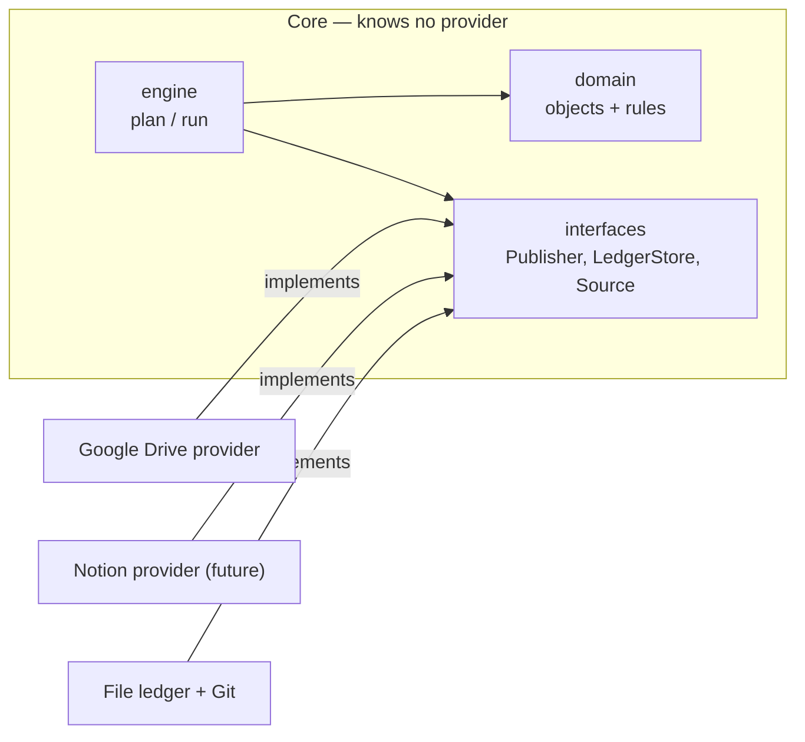

# Code Structure

**Related:** [domain model](domain-model.md) · [domain lifecycles](domain-lifecycles.md) · [system design](system-design.md) · [ADR-0002](adr/ADR-0002-ports-and-adapters.md) · [ADR-0006](adr/ADR-0006-ddd-ports-and-naming.md)

How the engine's code is organized, and the one rule that keeps it clean. This is the
**target** layout (per [ADR-0006](adr/ADR-0006-ddd-ports-and-naming.md)); the current PoC
isn't here yet — see [Current vs target](#current-vs-target).

## The idea: a core with plug-in providers

Think of the engine as a **core** with sockets. The core defines the socket shapes (the
**interfaces**) and runs the pipeline; **providers** are the plugs (Google Docs, Notion,
the ledger file, Git). The core never reaches out to a provider; providers are shaped to
fit the core.

> This is the "ports and adapters" (hexagonal) pattern from
> [ADR-0002](adr/ADR-0002-ports-and-adapters.md), in plain terms: an **interface** is a
> port, a **provider** is an adapter.



Arrows point **inward**: providers depend on the core; the core depends on nothing
outside itself.

## Folder layout

```text
src/
  domain/       Document, Publication, Ledger, Target — business objects + pure rules
  ports/        Publisher, LedgerStore — what a provider must implement
  app/          plan(), run() — orchestration; imports only domain + ports
  publishers/
    google-drive/   publishing provider (implements Publisher; owns docx rendering)
    notion/         (future) publishing provider
  adapters/     FileLedgerStore, git rename detection, ledger read/write + schema
  cli/          entrypoint — wires the providers to the core
```

> Names follow [ADR-0006](adr/ADR-0006-ddd-ports-and-naming.md): `ports/` (not
> `interfaces/`), `app/` (not `engine/`), `publishers/` + `adapters/` (not `providers/`).

## The one rule

`domain/`, `ports/`, and `app/` are the **core**. **Nothing in the core imports from
`publishers/` or `adapters/`.** Providers import the core to implement its ports; `cli/`
is the only place that knows which providers exist and wires them together. This is
enforced by `scripts/check-boundaries.ts` (`npm run lint:boundaries`), run in the
pre-commit hook and in CI, so it can't rot over time.

## Where each domain object lives

| Object                                                       | Lives in             |
| ------------------------------------------------------------ | -------------------- |
| `Document`, `Publication`, `Ledger`, `Target`, `PublishPlan` | `domain/`            |
| `Publisher`, `LedgerStore` (the ports)                       | `ports/`             |
| `plan()`, `run()`                                            | `app/`               |
| `GoogleDrivePublisher`, `NotionPublisher`                    | `publishers/<name>/` |
| `FileLedgerStore`, git rename detection                      | `adapters/`          |

## Where to add things

- **A new API-push surface** (Notion, Confluence, SharePoint) → a new folder under
  `publishers/` implementing the `Publisher` port. No change to the core.
- **A website (Docusaurus) or PDF** → _not_ a provider. It's a separate build job over
  the same `docs/` — it reads the source and builds, it doesn't publish per document.
- **A new storage or source backend** → a provider implementing `LedgerStore` / `Source`.

## Status: landed

The [ADR-0006](adr/ADR-0006-ddd-ports-and-naming.md) refactor is complete — the code now
matches this doc. What moved:

| Was (PoC)                                    | Now                                                                            |
| -------------------------------------------- | ------------------------------------------------------------------------------ |
| `orchestrator/plan.ts`, `run.ts`             | `app/`                                                                         |
| `providers/google-drive/*` (called directly) | `publishers/google-drive/` behind the `Publisher` port                         |
| `converters/markdown-to-docx`                | inside `publishers/google-drive/`                                              |
| `index/` (`IndexFile`, `readIndex`)          | `domain/ledger.ts` (`Ledger`) + `adapters/` (io + zod)                         |
| `PROVIDER = "google-drive"` constant         | `GOOGLE_DRIVE_PROVIDER_ID` on the publisher; `plan()` takes it as `providerId` |
| _(none)_                                     | `ports/` (`Publisher`, `LedgerStore`)                                          |

Not yet done: a `Source` port + `GitSource` adapter (git rename detection currently lives
as a plain module in `adapters/`), and a second publisher (Notion) to exercise the seam.
The `_index.json` wire format is unchanged — this was a rename, not a data migration.
