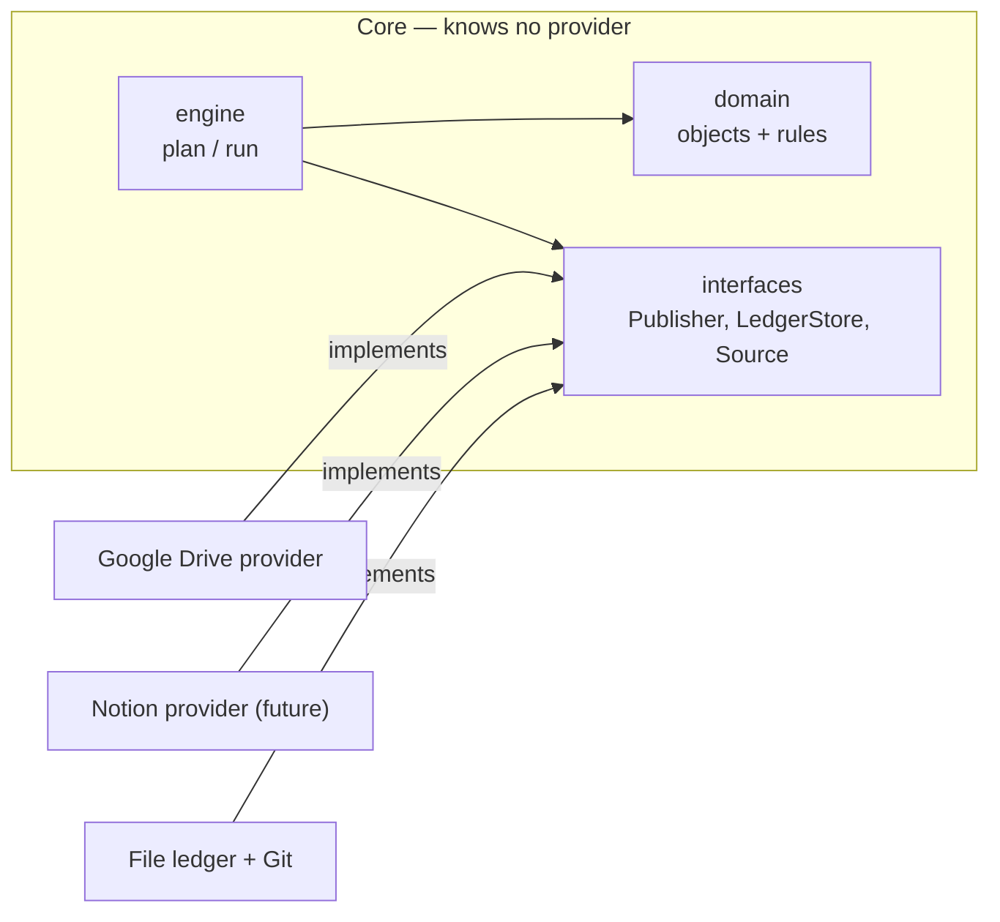

# Code Structure

**Related:** [domain model](domain-model.md) · [domain lifecycles](domain-lifecycles.md) · [system design](system-design.md) · [ADR-0002](adr/ADR-0002-ports-and-adapters.md) · [ADR-0006](adr/ADR-0006-ddd-ports-and-naming.md)

How the engine's code is organized, and the one rule that keeps it clean. This is the
**target** layout (per [ADR-0006](adr/ADR-0006-ddd-ports-and-naming.md)); the current PoC
isn't here yet — see [Current vs target](#current-vs-target).

## The idea: a core with plug-in providers

Think of the engine as a **core** with sockets. The core defines the socket shapes (the
**interfaces**) and runs the pipeline; **providers** are the plugs (Google Docs, Notion,
the ledger file, Git). The core never reaches out to a provider; providers are shaped to
fit the core.

> This is the "ports and adapters" (hexagonal) pattern from
> [ADR-0002](adr/ADR-0002-ports-and-adapters.md), in plain terms: an **interface** is a
> port, a **provider** is an adapter.



Arrows point **inward**: providers depend on the core; the core depends on nothing
outside itself.

## Folder layout

```text
src/
  domain/       Document, Publication, Ledger, Target — business objects + pure rules
  interfaces/   Publisher, LedgerStore, Source — what a provider must implement
  engine/       plan(), run() — orchestration; imports only domain + interfaces
  providers/
    google-drive/   publishing provider (implements Publisher; owns docx rendering)
    notion/         (future) publishing provider
    file-ledger/    storage provider (implements LedgerStore)
    git/            source provider (implements Source)
  cli/          entrypoint — wires the providers to the core
```

## The one rule

`domain/`, `interfaces/`, and `engine/` are the **core**. **Nothing in the core imports
from `providers/`.** Providers import the core to implement its interfaces; `cli/` is the
only place that knows which providers exist and wires them together. Enforce it with a
lint / boundary check so it can't rot over time.

## Where each domain object lives

| Object                                                       | Lives in                                   |
| ------------------------------------------------------------ | ------------------------------------------ |
| `Document`, `Publication`, `Ledger`, `Target`, `PublishPlan` | `domain/`                                  |
| `Publisher`, `LedgerStore`, `Source` (the interfaces)        | `interfaces/`                              |
| `plan()`, `run()`                                            | `engine/`                                  |
| `GoogleDrivePublisher`, `NotionPublisher`                    | `providers/<name>/`                        |
| `FileLedgerStore`, `GitSource`                               | `providers/file-ledger/`, `providers/git/` |

## Where to add things

- **A new API-push surface** (Notion, Confluence, SharePoint) → a new folder under
  `providers/` implementing the `Publisher` interface. No change to the core.
- **A website (Docusaurus) or PDF** → _not_ a provider. It's a separate build job over
  the same `docs/` — it reads the source and builds, it doesn't publish per document.
- **A new storage or source backend** → a provider implementing `LedgerStore` / `Source`.

## Current vs target

The PoC is layered but not yet organized this way: the orchestrator imports the Google
Drive functions directly, the ledger is named `Index`, and there is no `interfaces/`
folder. This doc describes the **target**;
[ADR-0006](adr/ADR-0006-ddd-ports-and-naming.md) is the refactor that gets there. Rough
current → target map:

| Current                                      | Target                                                     |
| -------------------------------------------- | ---------------------------------------------------------- |
| `orchestrator/plan.ts`, `run.ts`             | `engine/`                                                  |
| `providers/google-drive/*` (called directly) | `providers/google-drive/` behind the `Publisher` interface |
| `index/` (`IndexFile`)                       | `domain/` `Ledger` + `providers/file-ledger/`              |
| `converters/markdown-to-docx`                | inside `providers/google-drive/`                           |
| `PROVIDER = "google-drive"` constant         | `Target { name, type }`; publisher declares its `type`     |
| _(none)_                                     | `interfaces/`                                              |

Until the refactor lands, the code won't match this doc — that's expected, and called out
so no one is surprised to find no `interfaces/` folder yet.
