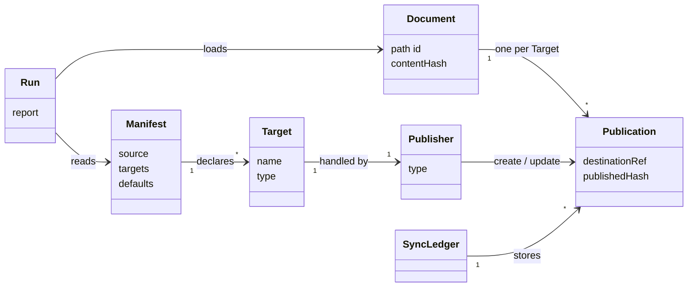
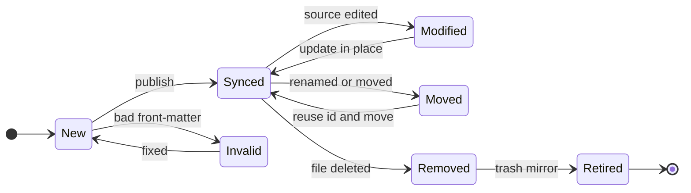
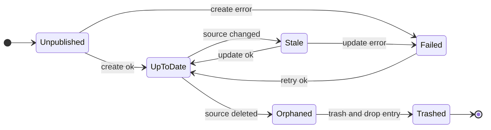
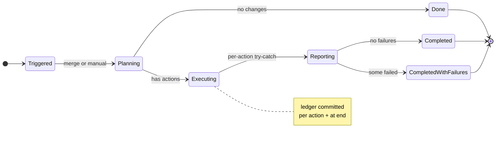

# Domain Lifecycles

**Related:** [domain model](domain-model.md) · [system design](system-design.md)

The [domain model](domain-model.md) lists the objects; this doc shows the three that
have a real **lifecycle** and how they interlock. Diagrams are Mermaid (render in GitHub
and Docusaurus).

## Which objects have a lifecycle

`Manifest`, `Source`, `Target`, `Publisher`, and the `Sync Ledger` are static (config or
stores). Three objects change state over time: **`Document`** (a source file),
**`Publication`** (one document on one provider), and **`Run`** (one execution).

## How the objects connect

One `Document` produces one `Publication` **per Target** — so a doc going to two
providers has two independent Publications.

## Document lifecycle

The life of a source file. `Invalid` is the side-trap for bad front-matter; `Moved` is
resolved via Git rename detection so the same mirror is reused.

## Publication lifecycle

The ledger's memory of one document on one provider — the object that enforces
idempotency. `Failed` is first-class, so retries never duplicate a mirror.

## Run lifecycle

The execution envelope. Per-action `try/catch` means one bad doc doesn't abort the
batch; the ledger is persisted during and after execution.

## How they interlock

The three machines nest by time-scale. A `Run` is the clock: one tick drives many
`Document` transitions, and each `Document` transition drives its `Publication`
transitions.

- A `Modified` document → its `Publication` goes `Stale → UpToDate` (update in place).
- A `Removed` document → its `Publication` goes `Orphaned → Trashed`.
- A `New` document → a `Publication` is created (`Unpublished → UpToDate`).

The `Document` machine answers "what happened to the file", the `Publication` machine
answers "what we did on each provider", and the `Run` machine batches them and sets the
exit code. The `Sync Ledger` is the persisted set of `Publication` states between runs.

Two consequences worth noting: adding a second provider (e.g. Notion) fans one
`Document` out to two independent `Publication` machines, so one provider failing leaves
the other `UpToDate`; and every failure lives in the `Publication` machine, not the
`Run`, which is what makes partial-failure isolation a property of the model rather than
a special case.
