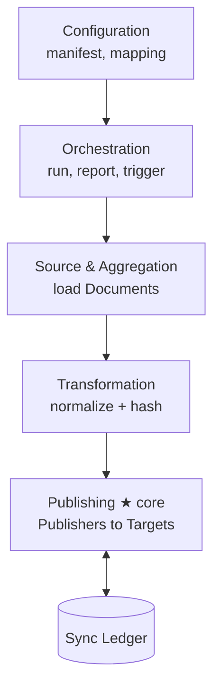

# Domain Model (DDD)

**Related:** [PRD](../product/prd.md) · [system design](system-design.md) · [ADR-0002](adr/ADR-0002-ports-and-adapters.md) · [testing](../testing/testing-strategy.md)

The ubiquitous language below is used verbatim in the PRD acceptance criteria, the system design, and the Gherkin scenarios.

## Ubiquitous language

| Term               | Meaning                                                                         |
| ------------------ | ------------------------------------------------------------------------------- |
| **Document**       | One Markdown file + parsed front‑matter. Atomic unit; id = path in a Source.    |
| **Source**         | Where Documents come from. V1: a Git repository.                                |
| **Content hash**   | Digest of normalized content; drives change detection.                          |
| **Manifest**       | `docpipe.yaml` — the unit of configuration (source, targets, defaults).         |
| **Target**         | A named, typed destination (e.g. `google-docs`).                                |
| **Publisher**      | Behaviour that delivers a Document to a Target. One per Target type.            |
| **Publication**    | Record of one Document on one Target: destination ref + published hash.         |
| **Sync Ledger**    | Durable store of Publications — the memory that makes publishing idempotent.    |
| **Pipeline / Run** | One execution: Discover → Load → Transform → Route → Publish → Record → Report. |
| **Mirror**         | A published copy. Always non‑authoritative and one‑way.                         |

We say **publish** (never "sync"/"export") and **Document** (never "page").

## Context map

Publishing is the **core domain** — pluggability across surfaces is the reason the system exists.



Git access and the Google Docs API are **generic subdomains** — they live inside adapters.

## Aggregates & key invariants

- **PipelineConfig** (root: Manifest) — every Target `name` unique; a Publisher exists for its `type`; a doc's `publish:` targets all exist.
- **Document** — well‑formed front‑matter or it's excluded + reported; hash is a pure function of normalized content (pipeline‑managed fields like `gdoc` excluded).
- **Publication** — at most one active per `(documentId, targetName)`; `destinationRef` is stable across Runs (update in place, never duplicate a Mirror).
- **Run** — one Document's failure never blocks others; Run is `failed` iff any outcome is `failed`.

## Domain events

`DocumentDiscovered` · `DocumentLoaded(hash)` · `DocumentInvalid(reason)` · `DocumentUnchanged` → **skip** · `DocumentPublished` → **create** · `DocumentUpdated` → **update in place** · `PublishFailed` · `RunCompleted(report)`

## Ports (domain‑owned; adapters implement — see [ADR-0002](adr/ADR-0002-ports-and-adapters.md))

```ts
interface SourcePort {
  list(c): AsyncIterable<DocumentRef>;
  load(ref): Promise<RawDocument>;
}
interface TransformPort {
  toModel(raw): DocumentModel;
} // parse front-matter, hash
interface PublisherPort {
  readonly type: string;
  publish(doc, target, prior?): Promise<PublishOutcome>;
} // create|update|failed
interface LedgerPort {
  get(docId, target): Promise<Publication | null>;
  put(pub): Promise<void>;
}
```

The Publishing context depends only on `PublisherPort`, so adding Docusaurus / PDF / AI later is a new adapter — no change to the core or existing Publishers.
