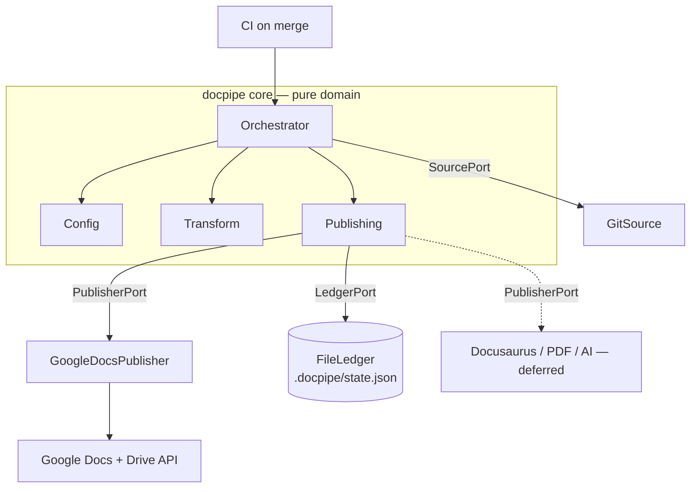
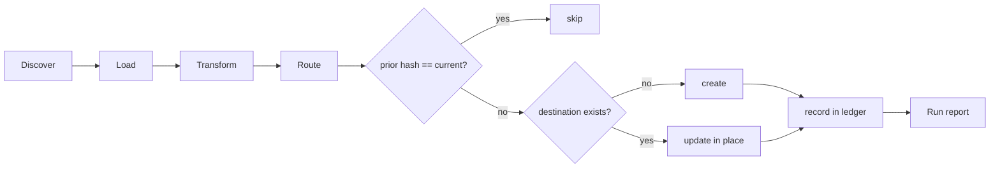
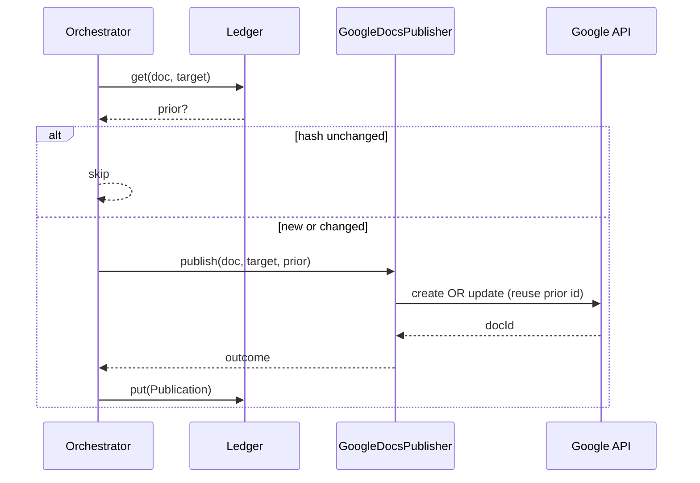

# System Design (V1)

**Related:** [PRD](../product/prd.md) · [domain model](domain-model.md) · [ADRs](adr/) · [testing](../testing/testing-strategy.md)

Hexagonal (ports & adapters): the domain core is pure; all I/O lives in adapters. New surfaces are new `PublisherPort` adapters — no core change.

## Components



## Run lifecycle



## Publish sequence (one Document → Google Docs)



## Idempotency & safety

- Change detection by **content hash**, not timestamps → re‑runs are no‑ops when nothing changed.
- **Stable destination** from the ledger's `destinationRef` → existing Doc updated in place, never duplicated.
- **One‑way:** the publisher only writes Git → Docs; it never reads Doc content back as source.
- **Dry‑run** prints the full create/update/skip plan without writing — used as a PR check.

## Sync Ledger (`_index.json`)

Path‑keyed and provider‑scoped: `entries[sourcePath].providers["google-drive"] = { fileId, url, lastSyncedHash }`. Enforces one active mirror per (path, provider). Add a top‑level **`lastSyncedSha`** (the commit synced last run) to enable Git rename detection. V1 commits it back via the CI bot with `[skip ci]` ([ADR-0003](adr/ADR-0003-config-manifest-multi-repo.md)); swap the file store for an external store behind the ledger port when concurrency grows.

## Run modes

Same engine and `plan()`/`run()`, two triggers:

- **Manual** — `npm run push` locally (or `workflow_dispatch`), for ad‑hoc syncs.
- **On merge** — `sync.yml` on push to `main` under `docs/**`; commits the updated ledger back with `[skip ci]`; a `concurrency` group serializes runs. PRs run the same `plan()` as a **dry‑run** check.

## Multi-repo adoption

Each repo `uses` the **shared, versioned engine + reusable workflow** and supplies only its own `docpipe.yaml` and its own `_index.json` ledger (config, not code). Non‑secret config (`driveFolderId`, `orgDomain`) lives in the committed manifest; the service‑account key is a CI secret. Adding a repo = one manifest + one secret.

## Reliability — partial-failure isolation

**Problem:** `runActions` currently throws on the first failing action and the ledger is written only after the whole loop. A Doc created just before a failure (e.g. a `grantDomainCommenter` error) is never recorded → the next run treats it as new and creates a **duplicate**.

**Fix:** wrap each action in `try/catch`, record the ledger entry **immediately after each successful create/update** (before the permission grant), persist per action, continue on error, and exit non‑zero if any failed.

```ts
export async function runActions(
  ctx,
  index,
  actions,
  writeLedger,
): Promise<{ next: IndexFile; failed: number }> {
  const next: IndexFile = {
    version: index.version,
    entries: { ...index.entries },
  };
  let failed = 0;
  for (const action of actions) {
    try {
      if (action.kind === "skip") continue;
      const docx = await markdownToDocx(action.body);
      if (action.kind === "create") {
        const folderId = await ensureFolderPath(ctx, action.segments);
        const { fileId, url } = await createDoc(
          ctx,
          folderId,
          action.name,
          docx,
        );
        upsert(next, action.sourcePath, {
          fileId,
          url,
          lastSyncedHash: action.hash,
        });
        await writeLedger(next); // persist BEFORE the grant → never orphan a Doc
        await grantDomainCommenter(ctx, fileId);
      } else if (action.kind === "update") {
        await updateDoc(ctx, action.fileId, action.name, docx);
        upsert(next, action.sourcePath, {
          ...prev(action),
          lastSyncedHash: action.hash,
        });
        await writeLedger(next);
      }
    } catch (err) {
      failed++;
      console.error(`FAILED ${action.sourcePath}: ${message(err)}`); // continue with the next action
    }
  }
  return { next, failed }; // caller exits non-zero when failed > 0
}
```

Trade‑off: persisting per action is more I/O; for hundreds of docs it's negligible. A lighter variant writes the ledger once in a `finally` — still crash‑safe for everything completed before the crash.

## Rename & delete handling

Today `plan()` only walks files that exist, so a removed or moved `.md` is invisible: a delete **orphans** its Doc and a move creates a **duplicate**. Add a reconcile pass that diffs the ledger against the current files.

The ledger is keyed by **source path**, which is enough for create / update / skip / delete. The one case it can't resolve alone is telling a **rename apart from a delete + create** — because a rename is exactly the event that changes the key. To re‑link the disappeared path to the appeared path, we need one signal that survives the move.

- **Delete** — a ledger entry whose source path no longer exists on disk → action `delete`: trash the Drive file (reversible) and drop the ledger entry. Configurable `onDelete: trash | archive | ignore` (archive = move to an `_Archived` folder).
- **Rename / move** — recognise it in this order:
  1. **Git rename detection (default).** The engine runs in Git, so ask Git directly. Store the **last‑synced commit SHA** in the ledger; on the next run, `git diff --find-renames --name-status <lastSyncedSha> HEAD -- docs/` reports `R  old  new`. Re‑key the ledger, reuse the Drive `fileId`, and move it to the mirrored new folder (`files.update` with add/remove `parents`). Git's similarity detection handles **move + edit in the same commit** — the case a hash can't.
  2. **Content‑hash match (fallback, no Git history needed).** A disappeared path + a new path with the same `lastSyncedHash` ⇒ rename. Zero new machinery (the hash is already stored), but misses move‑plus‑edit and is ambiguous for identical‑content files.
  3. **`syncId` in front‑matter (only if needed).** A path‑ and content‑independent id written into the file on first publish. Survives moves, full rewrites, and cross‑repo copies — but the engine must **write back into source `.md` files** (and backfill existing docs), so it's no longer read‑only on content. Reserve for cross‑repo copies or heavy move+rewrite where the URL must be preserved.

All three reuse the existing `fileId`, so document URLs stay stable across moves. Default to (1); it needs only one extra ledger field (the commit SHA) and never touches source files.

## Failure handling

| Failure                  | Behaviour                                                                           |
| ------------------------ | ----------------------------------------------------------------------------------- |
| Invalid manifest / env   | fail fast, non‑zero, no writes                                                      |
| Bad front‑matter (1 doc) | report invalid, skip that doc, continue                                             |
| API error (1 doc)        | `try/catch` records failure, continues others; run non‑zero; ledger holds successes |
| Transient / rate limit   | bounded retry + backoff in the provider, then fail that doc                         |
| Ledger write conflict    | `concurrency` group serializes runs; next run reconciles by hash                    |

## Revisit as it grows

External ledger store · central aggregation adapter · sensitivity‑aware Targets (private‑repo split) · more Publishers (AI index must inherit the site's access boundary).
