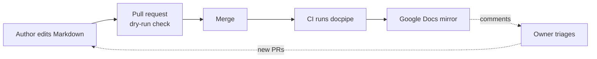

# PRD — Documentation Pipeline (V1)

**Status:** Draft · **Related:** [domain model](../architecture/domain-model.md) · [system design](../architecture/system-design.md) · [ADRs](../architecture/adr/) · [testing](../testing/testing-strategy.md)

## Problem

Product/technical knowledge is authored by PMs, engineers, and designers but consumed company‑wide (marketing, support, leadership, AI). It's scattered with no source of truth, so readers can't trust currency and authors maintain duplicates. V1 makes **Git + Markdown canonical** and **auto‑publishes to Google Docs**, adoptable by any repo without bespoke code.

## Goals

- Git + Markdown = single canonical store (one doc, one source).
- Config‑driven pipeline; adopt a repo via manifest + shared CI — zero repo‑specific code.
- Automate Markdown → Google Docs (one‑way) on every merge.
- Idempotent: unchanged docs skipped; stable destination per doc.
- Prove pluggability: Google Docs is one adapter; later surfaces are additive.

## Success metrics

- Onboard a repo in **< 30 min** (config only).
- **100%** of merges touching published docs update the mirror in one CI run (**< 10 min**).
- Re‑run with no changes = **0** writes.
- Lagging: **≥ 3** repos publishing; a 2nd publisher added with **no** core change.

## Non-goals (V1)

Docusaurus site · PDF export · AI index · versioning · per‑doc access control · two‑way Google Docs editing · WYSIWYG authoring. All designed‑for, not built.

## Workflow

## User stories (essentials)

- **Author:** write Markdown in my repo; declare targets in front‑matter; unchanged docs skipped.
- **Adopter:** add a manifest + call the shared workflow; point docs at my Drive folder.
- **Reviewer (non‑technical):** read/comment the current doc in Google Docs; trust it reflects the latest merge.
- **Owner:** see Docs comments to fold back as PRs.
- **Operator:** clear per‑doc report; one failure doesn't block others.

## Requirements (P0)

| ID   | Requirement                                                                                    | Acceptance (summary)                                                                                                                     |
| ---- | ---------------------------------------------------------------------------------------------- | ---------------------------------------------------------------------------------------------------------------------------------------- |
| P0-1 | Load Markdown + front‑matter from any repo's `docsDir`; hash each                              | every doc discovered, parsed, hashed                                                                                                     |
| P0-2 | Committed manifest (`docpipe.yaml`) for config + secrets via env/CI; fail fast on invalid      | missing field → non‑zero, no writes                                                                                                      |
| P0-3 | Google Docs publisher: create, then update in place                                            | new doc created + id recorded; changed doc updates same id                                                                               |
| P0-4 | Idempotent via Sync Ledger                                                                     | unchanged → skip, 0 writes                                                                                                               |
| P0-5 | Per‑doc target selection via `publish:`                                                        | `publish: []` → no target                                                                                                                |
| P0-6 | Run report + **partial‑failure isolation** (per‑action try/catch; ledger persisted per action) | one fail doesn't block others; successes recorded; run non‑zero; **no duplicate on re‑run**                                              |
| P0-7 | **Two run modes**, same engine: manual (`npm run push`) and on‑merge (`sync.yml`)              | both sync `docs/**`; on‑merge commits ledger back                                                                                        |
| P0-8 | **Handle deletes and renames/moves**                                                           | deleted source → Drive doc trashed + ledger entry dropped; moved source → same Drive file reused & moved, ledger re‑keyed (no duplicate) |

**P1:** dry‑run PR check · comment surfacing.
**P2 (design‑for):** more publishers · access‑controlled targets · versioning · central registry.

## Open questions

| #   | Question                                                                          | Owner              | Blocking |
| --- | --------------------------------------------------------------------------------- | ------------------ | -------- |
| 1   | Any sensitive docs? If yes, split to a private repo/target, **not** per‑page ACLs | Security / Product | **Yes**  |
| 2   | Ledger: commit‑back vs external store                                             | Eng                | Yes      |
| 3   | Google auth: shared vs per‑team service account                                   | Eng / IT           | Yes      |
| 4   | Mapping: front‑matter ids vs folder+title                                         | Eng                | No       |
| 5   | Reference language (TS/Node assumed)                                              | Eng                | No       |
