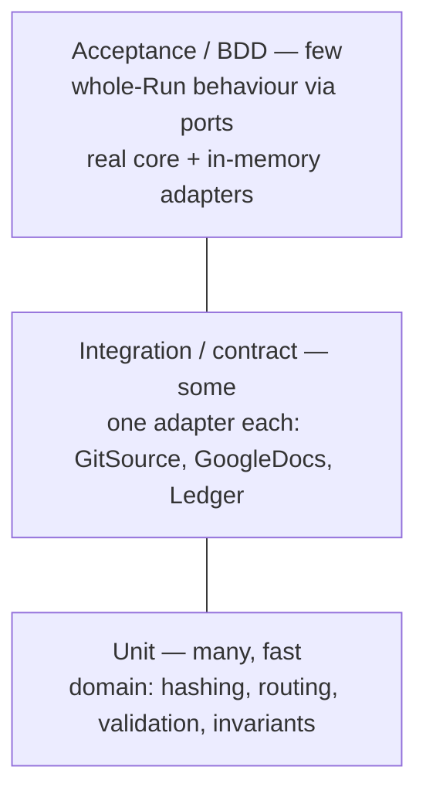
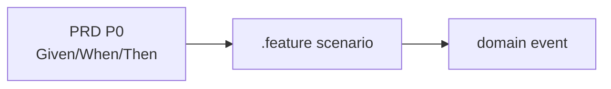

# Testing Strategy (BDD)

**Related:** [PRD](../product/prd.md) · [domain model](../architecture/domain-model.md) · [system design](../architecture/system-design.md)

Behaviour is specified in **Gherkin using the ubiquitous language**, and the specs are executable. Scenarios are the shared contract between PRD acceptance criteria, domain events, and code.

## Pyramid (mapped to contexts)



The acceptance layer runs the **real core** with **in‑memory adapters** (fast, no network); real edges are pinned by contract tests, so we avoid slow live‑API behaviour tests.

## Feature coverage (each traces to a P0)

| Feature file                  | Behaviour                                                      | P0   |
| ----------------------------- | -------------------------------------------------------------- | ---- |
| `discovery.feature`           | load Markdown + front‑matter; hash                             | P0‑1 |
| `manifest.feature`            | validate; fail fast                                            | P0‑2 |
| `publish_google_docs.feature` | create, then update in place                                   | P0‑3 |
| `idempotency.feature`         | skip unchanged; never duplicate a Mirror                       | P0‑4 |
| `routing.feature`             | per‑doc `publish:`; exclusion                                  | P0‑5 |
| `run_report.feature`          | per‑doc report; isolate partial failures; no dup on re‑run     | P0‑6 |
| `reconcile.feature`           | delete → trash + drop entry; rename → reuse file, move, re‑key | P0‑8 |
| `dry_run.feature`             | plan without writing                                           | P1‑2 |

## Canonical scenarios

```gherkin
Feature: Idempotent publishing
  Scenario: Unchanged document is skipped
    Given the Sync Ledger records the document at its current content hash
    When the pipeline runs
    Then the document is reported as "skipped"
    And no write is made to the "google-docs" target

  Scenario: Changed document is updated in place
    Given the document's content changed since last publish
    And the Sync Ledger holds a destination reference for it
    When the pipeline runs
    Then the document is reported as "updated"
    And the existing Google Doc is updated using the recorded reference
    And no new Google Doc is created
```

```gherkin
Feature: Run reporting and partial-failure isolation
  Scenario: One failing document does not block the others or cause a duplicate
    Given three documents selected for "google-drive"
    And the second document fails to publish
    When the pipeline runs
    Then the first and third are reported as "published"
    And their ledger entries are persisted
    And the second is reported as "failed"
    And the run exits non-zero
    And re-running does not create a duplicate for the first or third
```

```gherkin
Feature: Reconcile deletes and renames
  Scenario: A deleted source trashes its Doc and drops the entry
    Given a document present in the ledger
    And its Markdown file no longer exists on disk
    When the pipeline runs
    Then the Drive file is trashed
    And the ledger entry is removed

  Scenario: A moved source reuses the same Doc
    Given a document previously published at "docs/a/x.md"
    And Git reports it renamed to "docs/b/x.md" since the last synced commit
    When the pipeline runs
    Then the existing Drive file is reused (same id and URL)
    And it is moved to the mirrored "docs/b" folder
    And the ledger is re-keyed to the new path
    And no new Doc is created
```

## Doubles

`FakeSource` (in‑memory Documents) · `FakePublisher` (records create/update/skip) · `InMemoryLedger` (seeded per scenario) · contract fixtures for `GoogleDocsPublisher` (create returns id; update targets same id).

## Coverage & gating

- Domain unit: **≥ 90%** on Config/Transform/Publishing/Orchestration (invariants live here).
- Every P0 has ≥ 1 passing scenario; P0 scenarios are a **required** PR check.
- Each adapter must pass its contract test before it can be registered.
- PR also runs `--dry-run`; unexpected create/update counts can gate merges.

## Tooling (reference)

TS/Node: Cucumber (`.feature` + steps) + Vitest/Jest; hand‑written in‑memory adapters over mocking libs. Same strategy holds in any language (e.g. `pytest-bdd`) — scenarios are in the ubiquitous language, not code.

## Traceability (definition of done)


