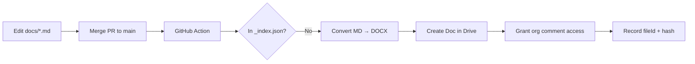
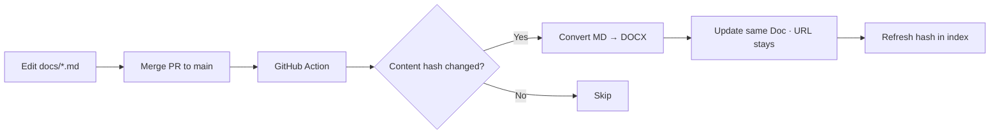

# Docs-Sync

Markdown in GitHub. Google Docs for the rest of the org.

---
layout: center
---

## What it does

- Markdown under `docs/` &nbsp;→&nbsp; Google Docs in Drive
- One-way sync, automatic on merge to `main`
- Folder hierarchy mirrored
- Read-only Docs &middot; org gets comment access

---
layout: default
---

## How it does

**Adding a new doc**

**Updating an existing doc**

---
layout: two-cols
---

## Benefits

**Engineering**

- Write in your editor
- Review in PRs
- Versioned in Git

::right::

  

**Product &amp; stakeholders**

- Read & comment in Drive
- Stable Doc URLs
- No GitHub account needed

---
layout: two-cols
---

## Architectural benefits

**Future extensibility**

- Provider-keyed index
- Drive today &middot; Notion / Confluence tomorrow
- New provider &rArr; no migration

::right::

  

**Maintainability**

- Pure converters &middot; no hidden state
- Three layers: orchestrator &middot; converters &middot; providers

---
layout: end
class: text-center
---

# Thank you

Questions?
